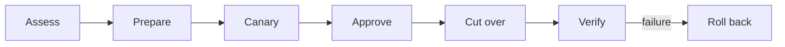

# 在显式权限内最大化自主性

Capability 告诉 worker 如何产生某种效果。Authority 指定了一个身份可以对哪种资源、在什么环境中、持续多久、以及在何种审批和恢复契约下产生哪种效果。将这些契约分开，可以在可逆环境中进行广泛的自主工作，在关键边界上则提供窄范围、可撤销的授权。

## 为可逆工作提供宽泛的权限范围

让 worker 在效果被隔离且可恢复的地方进行检查、编辑、构建、测试、模拟和迭代。在该权限范围内的大多数错误都是低成本的反馈。Ryan Lopopolo 的论点——[大多数错误并非后果严重]——将安全问题转向后果和恢复，而非要求零错误的随机性工作。

[大多数错误并非后果严重]:
  https://x.com/_lopopolo/status/2072102011546591295

Authority 授权应当明确：

- worker 身份；
- 操作和目标资源；
- 环境和范围；
- 授权有效期和撤销路径；
- 审批或职责分离要求；
- 审计回执和后置条件；以及
- 回滚或恢复路径。

Capability 契约可以保持稳定，而这些授权可以按身份、环境和后果进行变化。

## 将凭证保管与轨迹分离

命令可以在不使凭证对模型可见的情况下产生环境化效果。Broker 或 sidecar 可以在操作边界处从安全存储中解析窄范围的密钥材料，使 `gh` 表现得像普通工具，而密钥不会出现在模型上下文或仓库中。Ryan 同时描述了[凭证隔离目标]和[凭证由 sidecar 持有的环境化访问]。

[凭证隔离目标]: https://x.com/_lopopolo/status/2046021111440458027
[凭证由 sidecar 持有的环境化访问]:
  https://x.com/_lopopolo/status/2061150109232939288

一个内部产品的任务始于"读取 Slack 并识别传入的故障"这一目标，这样人们就不必将消息复制到轨迹中。要完成整个任务，需要 Slack 访问权限，然后是 agent 可请求的凭证，再然后是钥匙串访问和加密材料的安全处理。只有在构建好这条支撑路径之后，worker 才能回到故障分类。这种[凭证管理递归]属于 harness 的范畴，因为 worker 必须能够发现和使用组织能力，同时凭证保管、资源范围和审批仍然在操作边界上得到强制执行。

[凭证管理递归]:
  https://www.aakashg.com/how-pms-ship-100k-lines-of-code/#:~:text=the%20thing%20I%20have%20to%20build%20first%20is%20like%20credential%20management

[只读 agent 身份]使检查变得有用，而无需授予变更权限。[端点绑定访问]增加了一个独立的撤销边界：禁用一个面向 agent 的路由而无需暴露或轮换底层凭证。授权可以在轨迹仍在运行时过期或被撤回。

[只读 agent 身份]: https://x.com/_lopopolo/status/2046656417508294829
[端点绑定访问]: https://x.com/_lopopolo/status/2046026270132387870

人类身份和访问控制提供基线。Prompt 注入和模型可读的上下文使密钥隔离、资源范围和撤销变得尤为明确。[可识别的企业 worker] 描述将 agent 视为公司 IAM 下的身份，为安全和治理团队提供可检查的轨迹。工具调用、效果和轨迹记录构成该检查面；授权仍然以身份和操作记录为基础。

[可识别的企业 worker]:
  https://www.latent.space/p/harness-eng#:~:text=deploy%20highly%20observable%2C%20safe%2C%20controlled%2C%20identifiable%20agents%20into%20the%20workplace

## 分阶段执行高后果操作

将高后果工作拆分为多个阶段，每个阶段的权限和证据可以独立审查：

[让 Codex 为我的扫地机器人升级]使这一序列具体化。Loki 是一台运行开源 Valetudo 固件的扫地机器人。自定义 Tailscale daemon 提供其远程访问路径。Worker 可以检查发行版本、比较上游构建行为、构建候选版本并将其复制到隔离插槽。同一台扫地机器人上的第二个 Tailscale 身份和状态目录允许候选版本启动、加入 tailnet 并接受 SSH，而不会替换生产环境。

一个人对 canary 身份进行了身份验证。在 canary 证明了远程访问能力后，一次全新的生产备份和单独的审批守卫了切换过程。然后工作流验证了生产 SSH 和日志，再停止 canary daemon，同时保留其状态以供下次升级使用。因此两个人类授权对应不同的后果：创建新的网络身份和替换唯一的生产访问路径。

[让 Codex 为我的扫地机器人升级]:
  https://hyperbo.la/w/robot-vacuum-canary-tailscale/#:~:text=Human-in-the-loop%20work%20ended%20up%20being%20two%20operations

每个阶段仅授予其效果所需的权限。Canary 证明并不意味着生产权限；生产访问也不能证明部署的系统是健康的。[在真实环境中证明结果]负责提供关闭每个断言的证据。

[在真实环境中证明结果]: ../proof/

## 通过权限契约解释指令

"合并"指令意味着完成仓库的受保护工作流，而不会静默地授予绕过权限。"准备部署"的指令授予的是准备权限，而不是生产切换权限。当不可逆目标或范围在检查本地策略后仍然模糊时，worker 会在跨越边界之前询问。

人类参与遵循后果和可恢复性。一个错别字、一次可逆的测试部署、一次管理员合并和一次生产凭证轮换需要不同的门禁。主轨迹仍然可以拥有整个任务，同时仅在只有该人可以做出的有界决策时调用该人。

## 以机械方式编码已确定的边界

将稳定的权限规则放入身份策略、类型化域操作、限定范围的工具、环境边界、测试和合并门禁中。在后果证明限制合理的地方，使[错误操作不可用]。保留系统尚无法表达的判断指令。

[错误操作不可用]: https://x.com/_lopopolo/status/2044956579653673136

机械策略需要一个决策点。在 capability 边界处将请求的效果解码为类型化操作，根据身份的授权进行评估，并返回带有安全下一步操作的精确拒绝。相同的权限模型随后管理直接命令、计划任务和更高级别的域工具。
