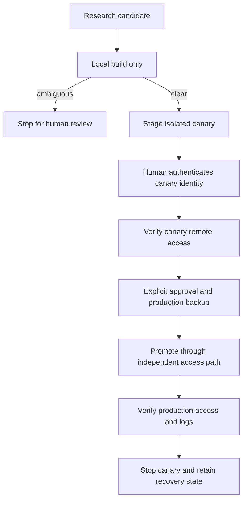
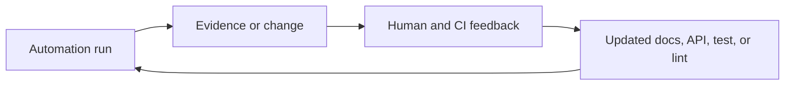

# 作为类型化控制平面的基础设施

Ryan 的私有 homelab 仓库将基础设施变更视为类型化、可测试的领域操作。它结合了基础设施定义、主机配置、已部署服务、本地操作员工具、生成的配置、监控、文档，以及可能切断自身恢复路径的操作。人类操作员和 agent 都必须能够在不从记忆中重建多年上下文的情况下采取行动。

## Harness 必须拥有的风险

该仓库跨越多个技术领域。声明式基础设施描述云和本地资源。配置管理收敛主机。已部署的 Go 服务在网络上运行。一个独立的 Go 领域提供本地开发和操作员工具。Python 支持基础设施自动化和 lint。Node 仅保留用于确定性的文本格式化。生成的监控配置必须与 inventory 和源配置保持一致。

这些表面具有不同的故障模式：

- 一个过时的文档可能产生错误但合理的运营决策；
- 一个重复的工具版本可能使本地和 CI 行为产生分歧；
- 一个浮动的 artifact 选择器可能在没有经过审查的仓库 diff 的情况下更改部署；
- 一个混合了解析、默认值和执行的命令可能静默地针对错误的系统；
- 一个格式错误的远程脚本在传输被截断时可能部分执行；
- 提供远程访问的软件升级可能破坏修复所需的访问路径；以及
- 移除依赖可以降低溯源风险，但同时增加本地拥有的正确性风险。

Harness 使这些风险可读，并将每个风险分配给一个架构或运营 owner。

## 及时路由上下文

根 agent 指南有意保持简短。它建立了操作 contract，映射主要仓库领域，命名正常的验证命令，并将工作路由到专业文档。这些文档承载 Go 设计、依赖审查、文档风格和高风险部署指导。

专业文档有各自不同的职责：

- Go 操作模型解释包所有权、类型化边界、capability 形状的接口和命令结构；
- 领域优先模型提供了将传输数据转化为持久领域值的实例；
- 依赖模型解释如何在标准库、受信任的专业库和仓库拥有的代码之间做出选择；
- 文档指南定义了什么属于持久运行记忆；以及
- 每个调度角色的版本化 contract 定义了范围、权限、验证、报告和升级。

这创造了渐进式披露。依赖更新不需要完整的部署运行手册。部署变更确实需要 Go 操作模型和相关的安全 contract。仓库是持久的记录系统。

指南还陈述了一个可重复的循环：对任务分类、读取路由的上下文、检查现有的所有权边界、进行有范围的变更、运行成比例的证明，并将任何新学到的持久经验记录在仓库中。最后一步将成功的会话转化为下一个会话更好的环境。

### 保持运营文档最新

一个调度的文档新鲜度角色使操作员指导与配置 homelab 的配置保持一致。它将操作员页面与配置管理、基础设施定义、监控、家庭自动化、仓库工具以及工作流和依赖元数据中的附近证据进行比较。每个发现命名过时或缺失的页面、矛盾或补充它的源配置、具体的修正，以及任何需要人类判断的不确定性。

该角色默认是只读的。它不能编辑文件、创建分支或在没有明确后续的情况下打开 pull request。它优先处理可能影响安全运营的漂移——inventory、路由、备份、监控、调度工作、版本和访问路径——而对仅风格的变动不予处理。本地仓库证据优先于推断；关于外部行为的声明需要权威的上游来源。

该角色的版本化 contract 还拥有其学习循环。人类对这些发现的响应、pull request 审查和失败的验证成为改进下一次扫描的候选项。自动化编写的评论带有稳定的标记，以便该角色不会将自己的输出误认为人类监督。

## 让架构承载指令

仓库将 Go 分为两个包 universe。一个包含本地操作员和开发工具；另一个包含已部署的服务和共享运行时包。已部署 universe 中的生产代码不能导入本地工具 universe。仓库 lint 强制执行该方向，而测试可以跨越边界来断言仓库范围的不变量。

这就是作为 prompt 的架构。Worker 不必推断部署策略 helper 是否属于运行时二进制文件。依赖方向回答了这个问题，CI 会拒绝错误的答案。

### 领域所有权优先于命令形状

命令围绕领域拥有的策略适配输入和执行。首选管道是：

```go
raw, err := flags.Parse(args)
if err != nil {
	return err
}

opts, err := options.Resolve(raw, inventory)
if err != nil {
	return err
}

return operation.Run(ctx, opts, capabilities)
```

这三个表示有意不同：

1. `raw` 保留操作员提供的内容；
2. `opts` 包含解析后的领域值和从显式真相来源解析的默认值；以及
3. 操作接收已经有效的值加上它所需的 capability。

自定义 lint 禁止在命令拥有的 flag 包之外进行原始 flag-set 构造。另一个限制直接进程构造仅限于少数 adapter 边界。领域包接收仓库根植的命令 capability 或窄传输接口，而不是自行发明工作目录、环境和子进程行为。

### 将关系保留在值中

外部 inventory 输出被解码为内部传输表示，并转换为保留其父上下文的领域值。因此，类主机的值知道回答命名和定位问题所需的类集群值。调用者从这些值请求一个完全形成的目标。

在泛化形式中：

```go
type Environment struct{ state environmentState }
type Machine struct {
	environment *Environment
	state       machineState
}

func (m Machine) Address() Address
func (m Machine) RemoteTarget() Target
```

这防止调用者在没有解释它所需的上下文的情况下持有机器。它还防止数十个调用者使用字符串独立地重建命名策略。

相同的技术出现在远程操作中。用户提供的目标字符串被解析一次为类型化的目标、源和目的地。读取、写入、复制和可达性是独立的 public capability。SSH、归档格式、校验和、暂存和 shell 命令仍然是内部机制。

## 使仓库策略成为语义代码

仓库包含一个集中的、仓库拥有的 lint 目录。它们用仓库特定的规则补充通用 linter。该目录目前保护的关注点包括：

- 本地工具和已部署代码之间的边界；
- 原始 CLI 解析的放置位置；
- 允许创建进程的少量包；
- 可执行入口点中的中断感知上下文；
- 格式化输出的已检查写入错误；
- 禁止本地 lint 抑制注释；
- 跨工作流、基础设施和包 manifest 的不可变选择器；
- 规范 Python 固定版本与工作流安装之间的一致性；
- 规范 Python 固定版本与静态分析语言目标之间的一致性；
- 发送到远程机器的 shell 模板的安全结构；以及
- 每个自定义 lint 和每个拥有的配置管理角色的可发现目的文档。

每个 lint 都有一个关于不变量及其存在原因的本地解释。其诊断包括补救路径。测试既练习活动仓库，也练习小型正面和负面的内存 fixture。这对 agent 很重要：失败会识别被违反的不变量和拥有修正的边界。

### 建模事实并解析规范文件

最强的策略检查通过领域解析器加载规范文件并提出语义问题：

```go
toolchains := LoadToolchainManifest(repo)
workflows := LoadWorkflows(repo)

node := toolchains.RequiredVersion(Node)
for _, setup := range workflows.NodeSetups() {
	requireEqual(setup.Version, node)
}
```

相同的模型用于 Go module、包 manifest、包管理器 workspace、Python 项目、Terraform 配置、工作流 YAML 和配置管理默认值。版本更改会更改规范数据及其拥有的 lockfile。测试从该数据派生预期的跨表面值。解析器 fixture 使用任意代表性版本来测试解析；它们不会成为另一个当前版本真相的来源。

这创造了一个重要的区分：

- **当前状态是数据**：运行时和工具版本存在于其规范 manifest 中；以及
- **持久策略是代码**：精确固定、冷却期、最低成熟度规则、已批准的信任类或所需关系可以成为命名的领域概念。

混淆这些类别会产生脆弱的策略：重复的当前版本常量、大型字符串构建的 fixture，以及每次升级时不相关的 fixture 编辑。将它们分离使日常维护变得简单，同时保持真正的不变量可执行。

## 让供应链策略跟随 capability

仓库携带少量分类的依赖集。它在它们拥有困难领域时保留专业库：基础设施语言的官方解析器、一流的云和网络客户端、成熟的系统集成、行感知 YAML 解析器，以及选定的高信任 Go 生态系统包。直接依赖按 capability 和上游信任边界分类。一个新的未分类直接依赖会失败并提示进行设计审查。

策略在添加或删除代码之前问四个问题：

1. 需要什么精确的 capability？
2. 哪个领域拥有它？
3. 该行为是否足够窄和稳定以在本地拥有？
4. 哪个选择产生更低的总体正确性、安全性、更新和维护风险？

这导致了几个具体的控制：

- 单个工具链 manifest 是语言和引导工具版本的规范来源；
- CI 设置步骤根据该 manifest 或语言的规范模块文件进行检查；
- 直接依赖和工具依赖必须属于已批准的 capability 类；
- 包管理器选择是精确的和完整性限定的；
- Node 没有运行时依赖表面，仅保留用于单个确定性格式化器；
- CI action 使用带有可读发布注释的不可变 commit 标识符；
- 运行器镜像被固定而不是通过移动的 `latest` 标签选择；
- 容器和下载的部署输入是版本化的或内容寻址的并带有校验和；
- 默认工作流权限是只读的，额外权限限定到需要它的 job；以及
- 云验证使用短期身份联合而不是存储的长期凭证。

### 一个策略，多个生态系统表示

一个小的领域值拥有冷却期，并将其渲染为依赖更新器、Node 包管理器和 Python 解析器期望的单位和语法。测试然后加载每个真实配置并将其语义值与共享策略进行比较。

这是一个紧凑但有代表性的 harness 模式：集中策略含义，同时每个生态系统保留其原生表示。仓库拥有它们之间的关系。

更新自动化添加了无法仅归结为 semver 的判断。它将上游分类为 patch-rich、patch-light 或 tagless；应用冷却窗口；检查权威发布 artifact；在它们提供回滚价值时保留旧校验和；将逻辑更新域分离为可审查的变更；以及在溯源或发布行为不明确时失败关闭。

## 在移除 Markdown 依赖时转移责任

已部署的文档服务曾经依赖一个通用的 Markdown 实现。仓库用一流实现替换了它，因为所需的方言是受限的，而通用依赖携带了比服务所需更多的 capability 和供应链表面。

替换将四个显式责任转移到仓库中：

- 抽象语法树定义了支持的文档模型；
- 解析器将源代码转换为该模型；
- 渲染器将模型转换为 HTML；以及
- 消毒器拥有 URL scheme、生成的标识符和 CSS 类 token。

支持的表面通过行为而不是不支持的完全标准兼容性声明来记录。信心来自几个独立的证明层：

- 服务真实功能集的黄金 Markdown/HTML fixture 对；
- 块和内联解析的边缘情况向量；
- 选定的上游 CommonMark 和 GitHub flavored Markdown 向量；
- 解析和渲染完整签入文档语料库的测试；
- 不安全链接 scheme、转义、片段生成、写入器错误和取消的测试；以及
- 解析器、语法树、渲染器和消毒器的聚合语句覆盖率，在正常启用 race 的测试路径中强制为 100%。

覆盖率棘轮分支执行。黄金向量和语料库测试建立兼容性；消毒器测试保护安全边界；race 和错误路径测试建立运营行为。

维护权衡是显式的。仓库从已部署服务中移除了一个上游维护者和传递图，但它接受了对解析模糊性、转义、标准漂移和未来功能请求的所有权。替换是可信的，因为当依赖表面缩小时，信心表面增长了。

## 将重要操作建模为 state machine

最清晰的运营示例是在受限的扫地机器人设备上升级远程访问软件。失败的生产替换可能删除修复设备所需的网络路径。因此 harness 将该操作建模为具有不同身份、状态和权限的阶段。



该调度角色可能会检查上游发布、比较功能选择行为、推理所需的网络能力，并执行本地交叉构建。它不能部署。缺失的发布说明、不明确的功能更改或涉及远程访问和路由的行为会停止自动化以供人类审查。

批准后，canary 使用单独的二进制槽位、运行时状态、通信 socket、日志和网络身份。暂存不得覆盖生产状态或重新启动设备。生产推广需要全新的备份。切换通过独立验证的 canary 访问路径执行，在隔离守护进程停止之前检查访问和日志。恢复状态被保留。

命令表面镜像 state machine。构建、canary 部署、canary 认证、canary 访问检查、生产备份、推广、生产验证和 canary 清理是独立的操作，而不是一个宽容部署命令上的标志。类型化目标和窄远程传输使阶段可单元测试。录制 fake 证明了每个阶段使用的身份、发生的远程写入，以及——关键的是——在 canary 工作期间不发生的生产变更。

远程 shell 脚本有另一个不寻常的防护栏。其可执行主体必须包含在一个 `main` 函数中，在末尾恰好调用一次。如果传输被截断，设备可能会收到定义但无法执行部分操作。自定义 lint 强制执行 shebang、严格模式、主体形状和单次最终调用。这是从通过远程传输流式传输脚本的实际故障模式中派生的一个小不变量。

## 用版本化自动化关闭反馈循环

调度 prompt 有意保持精简。它们标识一个角色并将 agent 引导到仓库中的版本化 contract。该 contract 定义：

- 拥有的范围和显式排除项；
- 默认模式是只读、产生变更、仅构建还是可部署；
- 要检查的权威来源；
- 冷却和风险分类；
- 所需的验证和证据；
- commit、pull request 和审查行为；
- 人类批准和中止条件；以及
- 最终摘要 schema。

示例包括依赖维护、文档新鲜度、受控客户更新、文档部署和高后果设备升级。文档新鲜度角色默认是只读的。高后果升级角色可以准备和构建但不能部署。常规文档发布者可能仅从干净的、当前的主分支检出进行部署，并让领域命令从规范 inventory 派生其目标。

自动化编写的评论带有稳定的标记，以便后续运行可以将其自身状态与人类审查区分开来。每个 contract 要求下一次运行检查人类反馈、失败的验证和后续请求，然后在重复相同类别的错误之前更新持久 contract 或防护栏。任务记忆存储运行特定的状态；仓库文档存储必须在运行中存活的行为。

这是一个具体的闭环：



## 从真相来源生成可观测性

仓库工具从类型化 inventory 和配置管理意图生成监控配置。它们应用领域选择规则并渲染 scrape 目标、服务状态指标和日志路由输入。检查模式将重新生成的输出与签入的 artifact 进行比较，并以刷新它的确切命令失败。

inventory 转换通过操作员工具使用的相同领域值更改监控视图。测试保护序列化之前的选择：哪些机器是当前的、哪些角色意味着日志 agent、哪些端点属于 scrape job，以及哪些已退役的目标必须消失。黄金输出验证最终渲染。

仓库还将期望的基础设施状态作为指标暴露，并为已部署的服务提供窄的就绪性和访问日志表面。远程渲染的配置可以通过类型化读取能力收集，以便与仓库意图进行比较。在高风险部署流程中，单独的 canary 和生产日志加上显式远程访问检查是必需的证明，而不是可选的故障排除辅助工具。

该模式比监控更广泛：从与操作相同的真相来源派生可观测性，并通过 agent 可以调用的有界命令使证据可用。

## 将证明匹配到变更的表面

本地验证接口按风险和 artifact 类型分组。它包括所有保留语言的格式化、通用 lint、工作流安全分析、基础设施验证、生成的配置检查、启用 race 的 Go 测试和 Markdown 覆盖率棘轮。窄目标支持迭代；在交付之前需要完整的相关目标。

CI 使用固定的工具链和不可变的 action 镜像这些表面。它构建和 race 测试 Go、验证生成的监控输入、独立检查基础设施项目、审计 Go 和 Node 依赖，并格式化或 lint Python、shell、YAML、Terraform、工作流和文本。跨文件策略测试验证 CI 消费规范版本，而不是成为第二个版本 manifest。

证明策略是刻意多元的：

- 解析器和值构造器获得表驱动测试；
- 策略包获得正面和负面 fixture 加上活动仓库检查；
- 生成的配置获得新鲜度或等价检查；
- 领域选择和目标构建在最终渲染之前进行测试；
- 远程操作使用录制传输来证明副作用及其缺失；
- 可见文档渲染使用黄金输出和完整语料库；以及
- 高风险操作保留人类审批、canary 证据、日志、访问检查和回滚状态。

将每个绿色勾号映射到它建立的声明。

## Harness 如何演进

仓库历史记录了一个由运营需求驱动的迭代推出。调度维护首先获得了版本化 contract 和稳定的反馈标记。然后将有风险的设备操作拆分为构建、隔离 canary、备份、推广、验证和恢复阶段。反复的依赖工作产生了规范 manifest 解析器、capability 分类、冷却策略和不可变选择器检查。一个依赖移除项目产生了拥有的 Markdown 边界、上游向量、语料库测试和覆盖率棘轮。领域重构然后产生了类型化远程目标、仓库根植的 capability、raw/resolved/executable 命令管道，以及防止回归的 lint。

这些规则来自观察到的运营和审查需求。一旦一个教训被证明是持久的，它就从补丁注释移入文档、领域 API、测试或 lint。实现序列记录了运营反馈如何变成持久的仓库结构。

## 维护和供应链结果

该方法产生了几个实际好处：

- 版本更改触及规范 manifest 和工具拥有的 lockfile，而不是复制的测试字面量网络；
- 命令继承一致的仓库根、取消、解析和默认值解析行为；
- agent 收到可操作的本地诊断，而不是依赖审查者的记忆；
- 调度角色可以在不继承部署权限的情况下进行有用的异步工作；
- 窄拥有的代码仅在本地可以重建信心时才替换宽泛依赖；以及
- 故障恢复在切换之前就被设计到高风险操作中。

它也有成本和限制：

- 仓库解析器和自定义 lint 是生产代码，需要测试；
- 100% 的语句覆盖率不能证明标准兼容性；
- 即使每个直接依赖都是合理的，多生态系统基础设施仓库仍然具有有意义的供应链；
- 上游发布检查和网络支持的新鲜度检查可能不明确或不可用；
- 除非持续与机器可读的源进行新鲜度比较，否则文档可能漂移；以及
- canary 隔离降低了部署风险，但无法使物理设备像一次性测试环境那样可复现。

依赖模型将拥有的代码视为负债，自动化在模糊性处停止，高风险运行手册保留人类关卡。

## 可迁移的单元

可复用的单元是一组关系：

1. **路由上下文：** 保持根指南的导航性，将推理放在消费它的领域旁边。
2. **分离数据与策略：** 从规范 manifest 读取当前版本和 inventory；仅在策略代码中编码持久关系和风险规则。
3. **建模操作：** 将外部语法解析一次，用显式知识解析默认值，并将类型化值传递给领域。
4. **约束 capability：** 使进程执行、文件系统范围、远程传输、凭证和部署权限成为显式依赖。
5. **用防护栏教学：** 每个本地 lint 都应该命名被违反的不变量和首选修复。
6. **用信心替换信心：** 当删除依赖时，添加覆盖新拥有责任的 fixture、对抗性案例、语料库测试和强制执行。
7. **将风险建模为 state machine：** 当操作可能破坏其自身的控制平面时，分离评估、构建、canary、批准、备份、切换、验证和恢复。
8. **关闭循环：** 将反复的人类反馈、失败的运行和运营意外转化为最早的持久文档、API、测试或 lint。
