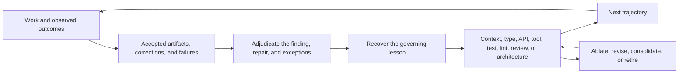

# Preserve Coherence and Own Lifetime Risk

Coding agents 可以使实现尝试变得丰富，而每一次被接受的更改仍然会给共享系统增加约束和维护义务。产品意图、兼容性契约、迁移纪律、dependency 决策、证明语料库和发布身份决定了 [the next 5,000 changes] 是否能累积成一个连贯的系统。Ryan Lopopolo 将这种变化的经济学描述为 [abundant implementation]，而未来的持有成本仍由仓库承担。

[abundant implementation]: https://x.com/_lopopolo/status/2032592873502421333
[the next 5,000 changes]: https://x.com/_lopopolo/status/2052834431996666267

## 使连贯性成为累积的

OpenAI 团队在开创性的 harness-engineering 文章背后的团队，从一个空仓库开发了 [an internal product] 五个月。Codex 生成了大约一百万行代码和约 1,500 个合并的 pull request。内部发布和采用表明该策略在初始开发期间是有效的。架构在多年后会如何表现——当 agents 重复已接受的模式，而后续模型改变了 worker——仍然是该文章关于 [long-term architectural coherence] 的开放问题。Ryan Lopopolo 后来将目标命名为 [long-term coherence of agent-produced artifacts]，并观察到 [work is an iterative game]。每条轨迹都是暂时的；其周围的环境可以将一次实际结果的判断带入后续的工作中。

[an internal product]:
  https://openai.com/index/harness-engineering/#:~:text=Five%20months%20later%2C%20the%20repository%20contains%20on%20the%20order%20of%20a%20million%20lines%20of%20code
[long-term architectural coherence]:
  https://openai.com/index/harness-engineering/#:~:text=What%20we%20don%E2%80%99t%20yet%20know%20is%20how%20architectural%20coherence%20evolves%20over%20years
[long-term coherence of agent-produced artifacts]:
  https://x.com/_lopopolo/status/2052834649152618908
[work is an iterative game]: https://x.com/_lopopolo/status/2052858891835465813

[Code Reds Need Maintenance Loops] 认为，紧急响应应该为它发现的不变量留下一个维护的人工、程序化或 agentic 循环。[Run Known Work as a Continuous Loop] 描述了由此产生的运营契约。

[Code Reds Need Maintenance Loops]:
  https://hyperbo.la/w/code-reds-need-maintenance-loops/#:~:text=That%20understanding%20should%20become%20a%20maintenance%20loop%20the%20team%20leaves%20behind
[Run Known Work as a Continuous Loop]: ../continuous-maintenance/

Harness engineering 将同样的方法应用于 agent 轨迹。被接受的 artifact 保留了质量标准的示例。修正、失败的发布、事件和用户反馈揭示了结果与该标准之间的差距。Harness 保留了证据，区分了一个发现与其提出的修复方案，从审查过的结果中学习，并将每个稳定的教训提升到其最早的持久所有者。[The Production Function Changed] 用一个缺失的 `fetch` 策略说明了这个序列：将其编码为具有 100% 代码覆盖率和详尽的表驱动测试的防护措施，一次性迁移整个代码库，并为后续违规产生描述性的失败。

[The Production Function Changed]:
  https://hyperbo.la/w/production-function-changed/#:~:text=that%20guardrail%20into%20place%20with%20100%25%20code%20coverage%20and%20exhaustive%20table-driven%20tests%2C%20migrate%20the%20codebase%20in%20one%20go

已确定的不变量可以通过类型、API、工具、lints 和架构规则成为有界的保证。完整的迁移在现有群体中建立这些不变量；可执行的棘轮在后续工作中保留它们。保证仅延伸到不变量和执行表面忠实建模真实需求的程度。上下文判断仍然可以通过指导、示例和审查来检索。[Turn Feedback Into Infrastructure] 追踪了一个教训如何从证据转移到适当的所有者。

[Turn Feedback Into Infrastructure]: ../feedback/

已知故障类别的覆盖范围在控制措施合并时不断积累。一个点修正始于证据；持久的教训可能属于上游的领域模型或架构，从而使另一个下游验证器变得冗余。[Blessed work] 提供了品味和结构的信息密集型正面示例，这是负面检查无法表达的。一个可博弈的评分器可以在实际结果退化时奖励代理指标，而设计一个 [unhackable grader] 本身就是困难的。后续运行需要声称边界的证据来证明干预措施改善了实际结果。园艺在过时、过拟合和冗余的控制措施变成竞争性指令之前将其移除。

[Blessed work]: https://x.com/_lopopolo/status/2054037448297201696
[unhackable grader]: https://x.com/_lopopolo/status/2056991142093508831

## 为接下来的 5,000 次更改优化

未来的速度是今天验收标准的一部分。每次更改都应该为后续更改留下一个连贯的基础。累积的持有成本通过请求的结果进入：架构、迁移完成度以及对未来工作的影响。

丰富的 agent 劳动力降低了实现尝试的成本。集成、排序、兼容性和未来的遗憾仍然昂贵。一个已知的完整迁移具有可发现的群体和确定的目标。[The no-await-in-loop migration] 启用了 lint，在同一个 pull request 中修复了 600 个违规并详尽地添加了测试覆盖。其群体和完成定义在机械上是可读的。

[The no-await-in-loop migration]:
  https://hyperbo.la/w/production-function-changed/#:~:text=I%20turned%20on%20no-await-in-loop%20from%20ESLint,exhaustively%20add%20test%20coverage

架构性项目的形态不同。[The existing architecture may be the source of the drag]，目标不变量可能是可读的，但安全路径仍需学习。中间更改需要自身有用、可以在常规仓库流量中合并、可逆或可替代，并且能够降低后续集成的风险。

[The existing architecture may be the source of the drag]:
  https://x.com/_lopopolo/status/2052837107400679555

Artichoke 是一个用 Rust 构建的 Ruby 实现，围绕 mruby（一个用 C 编写的 Ruby 虚拟机）构建。Rust 拥有的解释器状态跨越到 C 调用中，这些调用可以回调到 Rust，同时 mruby 的垃圾回收器在运行。2020 年的设计将所有状态存储在 `Rc<RefCell<State>>` 后面，这提供了共享所有权和运行时借用检查。该包装器阻止了状态组件的独立借用，而 Ruby 核心和标准库实现通过公共解释器能力深入到 VM 内部。

[Artichoke's state-model refactor] 尝试在 Rust 到 C 的 VM 调用、C 到 Rust 的回调、垃圾回收、公共解释器 API 和扩展代码中替换该所有权模型。Pull request #442 将该修正合并为一个无法编译的 114 文件更改。该工作随后分散到 50 个合并的准备 pull request 中，同时 200 个 pull request 落地到仓库中，之后又经历了更多的大型集成尝试和运行时失败，直到替换被合并。每一次接受的更改都必须为最终集成改善基础，同时在移动的仓库中保持有用。开放的 harness 问题是如何帮助 worker 选择独立有用且使最终集成更安全、更容易继续的中间状态。

[Artichoke's state-model refactor]: ../../evals/artichoke-state-modeling.md

diff 的大小和运行时间几乎没有提供关于安全路径是否已知的信息。在另一个案例中，Ryan 描述了 [a 60-hour, 350-million-token refactor]——他职业生涯中最困难的重构之一——在一个初始提示和两次后续提示之后作为一个 pull request 完成。Artichoke 需要一系列独立合并的准备工作，因为路径本身仍然不确定。Ryan 的短语 [fear of another fifty pull requests] 命名了缺失的能力：在未来的更改中预期遗憾。持久的计划、决策状态、dependency 关系和棘轮使更多的视野可观察。Ryan 将跨该视野的可靠远见视为一个开放的能力问题。[Software Work Is No Longer Scheduled] 将困难的接口重构保留在仍需持续人工判断的工作中。

[a 60-hour, 350-million-token refactor]:
  https://www.aakashg.com/how-pms-ship-100k-lines-of-code/#:~:text=350%20million%20tokens%20on%20a%20single%20PR
[fear of another fifty pull requests]:
  https://x.com/_lopopolo/status/2064221034547753105
[Software Work Is No Longer Scheduled]:
  https://hyperbo.la/w/software-work-not-scheduled/#:~:text=Building%20a%20product%20from%20zero,all%20require%20sustained%20human%20judgment

每一次被接受的中间更改都成为下一条轨迹的 prompt 素材。[Canonical local examples] 塑造了直接的延续；持久的契约和所有权在许多重写中保持连贯性。

[Canonical local examples]: ../domain-modeling/

## 选择必须在重写中存活的内容

实现可以是探索性证据、生成的输出，或持久契约的一种呈现。保留表达产品意图的 artifact，并让新的实现证明等价性：

- 行为和领域规范；
- 兼容性表面和迁移规则；
- 决策和架构边界；
- dependency 和供应链策略；
- 证明语料库和已知故障案例；以及
- 发布身份和运营契约。

Symphony 是一个基于 issue tracker 的系统，用于监督 coding agents。它发布一个行为规范，团队可以从中生成独立的实现，因此 [Stop Treating Code as the Artifact] 称其为"幽灵库"：共享的契约是依赖，而没有共享的代码包。一个 [specification-distillation loop] 可以从一个受祝福的实现中恢复该契约，评估一个新的实现，并从比较中细化规范。探索性代码在揭示了有用的序列、不变量或缺失边界后就是可丢弃的。[feedback loop] 将该教训提升到最小的持久所有者，使下一个实现能够继承它。

[Stop Treating Code as the Artifact]:
  https://hyperbo.la/w/code-is-not-the-artifact/#:~:text=the%20spec%20is%20the%20distribution%2C%20and%20the%20source%20tree%20is%20one%20generated%20artifact
[specification-distillation loop]:
  https://x.com/_lopopolo/status/2051410617937125508
[feedback loop]: ../feedback/

Ryan 关于 [replace "codebase" with "artifact"] 的指令将此连贯性循环扩展到源代码仓库之外。代码可以保留在轨迹中，而用户审查领域结果及其证明；[last-mile deployment] 提供了周围的上下文、能力和权限。

[replace "codebase" with "artifact"]:
  https://x.com/_lopopolo/status/2076878736507736390
[last-mile deployment]: ../last-mile-deployment/

## 将 dependency 视为所有权决策

Dependency 决策选择了谁将在仓库的生命周期内维护和验证某项能力。受信任的上游专家可以拥有复杂且不断发展的标准。当所需的行为是稳定的、透明的、领域核心的且测试成本低廉时，狭隘的第一方实现可以降低风险。

OpenAI 团队用一个 [first-party map-with-concurrency helper] 替换了通用的 `p-limit` 风格的 dependency，该 helper 量身定制以适应其运行时。该 helper 与仓库的 OpenTelemetry 检测集成，并具有完整的测试覆盖。将此有界能力引入内部使其行为在仓库中可检查和可修改，同时将每次未来修正和扩展的责任转移给团队。

[first-party map-with-concurrency helper]:
  https://openai.com/index/harness-engineering/#:~:text=we%20implemented%20our%20own%20map-with-concurrency%20helper

[internalized-dependency burden] 是明确的：一个本地实现开始时没有任何上游项目积累的规模、兼容性或安全信心。仓库必须为它现在拥有的子集重建证据。

[internalized-dependency burden]:
  https://www.latent.space/p/harness-eng#:~:text=to%20internalize%20that%20dependency%2C%20you%E2%80%99re%20back%20to%20zero

## 当所有权转移时重建信心

移除一个包会将兼容性、安全、来源、更新和维护责任转移到仓库中。证据可能包括一个真实语料库、一致性和负面 fixture、fuzzing 或属性测试、来源审查、明确的包所有权，以及新输入或标准变更的计划。

[Dependency Ownership] 为保留、内部化或分叉一项能力开发决策记录。它还记录了信任类别，例如显式批准的 `golang.org/x/` 命名空间，而不会将每个第三方来源扁平化为一个风险类别。

[Dependency Ownership]: dependency-ownership.md

## 保持策略的权威性和控制措施的成比例

当前的固定版本属于权威清单。策略代码拥有稳定的关系，如批准的主要版本线、信任类别、冷却期和必需检查。[supply-chain posture] 将这些关系与主要单一工具链系统、经过审查的小型 dependency 集合以及安全更新的可靠路径结合起来。

[supply-chain posture]: https://x.com/_lopopolo/status/2059023029666214126

每一个持久的控制措施都带来维护和关注成本。为一个具体的故障类别或有价值的不变量添加一个，将其放置在最早的语义所有者处，并退役较弱的重复项。询问谁维护它，它增加了什么证据，以及它在多大程度上减慢了常规循环。

[Harness Engineering the Blog Build (Again)] 将此姿态应用于一个工具链和工作区，集中式 dependency 目录、语义领域类型、显式包所有权和仓库特定的结构检查。控制措施强化了一种架构，并避免了旁边的第二个策略系统。

[Harness Engineering the Blog Build (Again)]:
  https://hyperbo.la/w/harness-engineering-the-blog-build/#:~:text=codify%20repo%20contracts%20as%20tools%20and%20lints%20instead%20of%20tribal%20memory

## 保留发布身份

交付的 artifact 应该是经过测试的 artifact。在更大的部署权限下重建会引入第二个供应链并切断先前的证明。[release-integrity note] 在运行边界上开发了不可变的 artifact 身份、来源、canary 证据、批准、回滚和验证。

[release-integrity note]: ../proof/release-integrity.md

持续的重新固定、文档园艺、兼容性退役和世界模型刷新属于 [continuous maintenance loop]。终身所有权定义了必须保持为真的内容；循环随着仓库、生态系统和 worker 的变化而保持该关系的当前状态。

[continuous maintenance loop]: ../continuous-maintenance/
