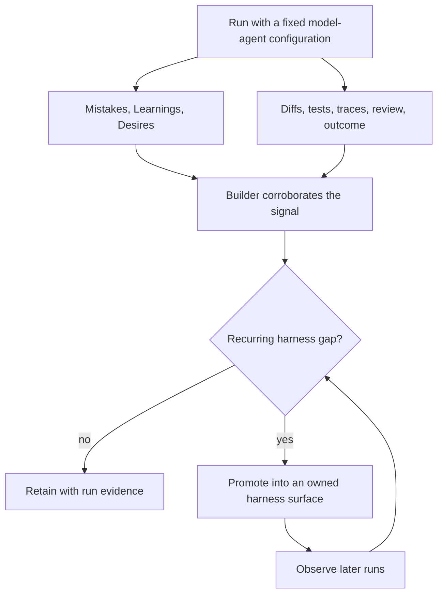

# MLD：为 Harness 构建者提供的遥测

Ryan 的 [initial MLD instruction] 要求 agent 在工作时记录三类观察：

- **Mistakes**：agent 在自身轨迹中注意到的错误；
- **Learnings**：agent 不得不发现的关于环境的事实；以及
- **Desires**：agent 希望拥有的上下文或工具。

[initial MLD instruction]: https://x.com/_lopopolo/status/2037307669464363433

他后来将其命名为 [the MLD framework]，将文件描述为 [as agent telemetry]，并明确了其消费者：[they are for the agent builder]。MLD 定义了一个传感器及其消费者。Harness 构建者仍然需要一个运营策略来处理验证、提升、过期和隐私；下面的协议就是这样一个策略。

[the MLD framework]: https://x.com/_lopopolo/status/2052091245296861574
[as agent telemetry]: https://x.com/_lopopolo/status/2037307926902403558
[they are for the agent builder]:
  https://x.com/_lopopolo/status/2052095157336703410

## 三种信号

### Mistakes 定位失败轨迹

Mistake 标识了尝试的路径偏离工作的节点。它可能揭示缺失的上下文、模糊的接口、薄弱的传感器、缺失的能力或一次性模型错误。

报告是线索。差异、工具输出、失败的检查、评审发现和最终结果决定了实际发生了什么。

### Learnings 记录发现

Learning 记录了 agent 不得不发现的环境事实。代价高昂或反复的重新发现可能揭示缺失、隐藏或路由不当的流程数据：哪个清单是规范的、所有权在哪里、测试为什么存在、部署如何分阶段，或者哪个看似简单的路径不安全。在将 learning 视为 harness 缺陷之前，将其与轨迹进行比较。

这些事实通常是私有的、变化的、特定于仓库的或隐式的。组织不能假设通用模型权重包含它们，或者 agent 会可靠地推断哪些事实约束着任务。

### Desires 定位缺失的外部杠杆

Desire 标识了可能缩短轨迹的上下文或工具：日志、浏览器视图、清单解析器、领域命令、架构决策或窄范围权限。

Agent 只能请求它能想象到的东西，而其提议的补救措施可能是错误的。有用的问题是该请求是否暴露了反复出现的人类传递或当前 harness 无法检测到的重要失败。

## 构建者决定什么保留

Prompt 对运行进行仪表化，文件记录 agent 的经验，独立证据检验该叙述，构建者决定 harness 是否应更改。

## 从运行到干预

对于每次运行，使用以下步骤：

1. 在运行期间要求简洁的 MLD 报告；
2. 将它们与轨迹和结果一起存储；
3. 用确定性证据和人工评审验证每条声明；
4. 按底层缺失项对反复出现的信号分组；
5. 更改关闭该缺失项的最小权威界面；以及
6. 在后续运行中验证干预是否减少了失败或传递。

同时更改固定的 model-agent 配置会使结果变得模糊。MLD 属于 harness engineering，因为干预措施针对上下文、工具和策划的环境。

## 将信号提升为拥有的界面

原始报告只有在经过验证后才能成为普通的仓库 artifact：

| 信号                                       | 验证证据                    | 可能的目标位置                          |
| -------------------------------------------- | ----------------------------------------- | --------------------------------------------- |
| 包反复放置在错误的层 | 评审历史和依赖图       | 架构指南和结构化 lint        |
| 生成的文件被手动编辑                | 差异和过期输出失败           | 可发现的生成器和 CI 新鲜度检查 |
| 部署目标从字符串重建 | 命令追踪和险些失败            | 有类型的目标和试运行命令              |
| 规范清单被反复重新发现   | 搜索轨迹和评审者纠正 | 简短的路由文档                   |
| 需要的浏览器状态不可用             | 手动传递和缺失的运行时证据 | 浏览器工具或可观测性界面         |

提升即分配所有权。稳定的边界属于架构。当前版本属于其清单。危险操作属于操作手册和窄范围命令。已知失败属于测试或 lint。特定于运行的观察随运行保留。

将经过验证的信号提升到更小、更清晰的 harness 中，并将原始建议与产生它的运行一起保留。

## 将原始遥测数据排除在 agent 上下文之外

自动将 MLD 注入后续运行会将观察和控制折叠到一个通道中。这会产生反馈循环风险：

- 不正确的 learning 作为指令自我强化；
- 任务本地状态伪装成持久事实；
- 重复项消耗上下文但不改变决策；
- 过期条目在仓库更改后仍然存活；
- 敏感材料跨越其预期边界；以及
- 对 MLD 的评分要求奖励看似合理的自我评论而非好的结果。

将原始文件附属于产生它们的运行。如果团队维护跨运行的汇总，构建者负责去重、验证、过期和提升。Agent 可以在审计期间检查经过精心选择的报告；这与将整个累积视为可信上下文是不同的。

## 在分离激励下的自报告

OpenAI 的 [confessions research] 研究了相关的外循环报告。在发布后，同一模型生成关于其遵循、违反或仍然不确定的目标的结构化叙述。一个独立的评审者对该叙述进行评分，而由此产生的奖励仅用于训练忏悔本身。研究人员在分布外压力测试上评估该通道，旨在引出奖励破解、阴谋、隐蔽规则违反和其他明知故犯的不良行为。在这些概念验证实验中，对于经过特殊训练的模型，分离的激励和诱导的失败使忏悔通道在 worker 是否故意隐瞒不合规方面比普通的 MLD 指令具有更强的经验基础。结果因评估而异，该工作并未确定每次忏悔都是可靠的。

[confessions research]:
  https://openai.com/index/how-confessions-can-keep-language-models-honest/#:~:text=We%20trained%20a%20version%20of%20GPT%E2%80%915%20Thinking%20to%20produce%20confessions,stress%2Dtest%20datasets%20designed%20to%20elicit%20behaviors

该设计为 MLD 提示了类似的运营规则。忏悔训练使用 [reward separate from the main answer]；原始 MLD 在验证之前仍然是 harness 构建者的证据，而不是成为可能影响 worker 下一个任务的指令。

[reward separate from the main answer]:
  https://openai.com/index/how-confessions-can-keep-language-models-honest/#:~:text=During%20training%2C%20a%20confession%20is%20evaluated%20by%20a%20separate%20reward%20model,never%20influence%20the%20reward%20for%20the%20main%20answer

Chain-of-thought 在论文中扮演较窄的角色。忏悔评审者 [does not receive the policy's chain-of-thought]，该方法 [works when the answer contains no chain-of-thought]。Chain-of-thought 出现在研究人员的假阴性审计中。忏悔通道在 [adversarial pressure remains future work] 下的稳健性仍有待研究。

[does not receive the policy's chain-of-thought]:
  https://arxiv.org/html/2512.08093v2#:~:text=We%20do%20not%20show%20it%20any%20of%20the%20policy%E2%80%99s%20chain%2Dof%2Dthought
[works when the answer contains no chain-of-thought]:
  https://openai.com/index/how-confessions-can-keep-language-models-honest/#:~:text=Importantly%2C%20the%20early%20results%20show%20that%20confessions%20remain%20effective,across%20future%20model%20architectures
[adversarial pressure remains future work]:
  https://arxiv.org/html/2512.08093v2#:~:text=We%20would%20also%20be%20interested%20in%20understanding%20how%20robust%20confessions%20are%20to%20adversarial%20pressure,out%2Dof%2Ddistribution%20data

MLD 没有单独训练的诚实性奖励或压力测试证据，因此其报告仍然是低可信度的假设。其开放的 Mistakes、Learnings 和 Desires 类别解决更广泛的运营问题：隐藏的组织上下文、缺失的工具、反复重建以及可能在没有策略违反的情况下发生的摩擦。这种广度可能暴露固定策略合规模式未预料到的维度，但它不会增加报告的证据权重。追踪、差异、测试、评审和结果决定构建者提升什么。

## MLD 无法证明什么

自报告是片面的和有偏差的。Agent 可能会错过其最重要的错误、错误识别原因、请求错误的能力或为坏结果寻找合理化理由。Desire 不能证明应该存在新工具。Learning 不能证明所学到的事实是真实的。沉默不能证明环境是充分的。

将 MLD 与以下内容一起使用：

- 确定性测试和 lint；
- 工具追踪和失败输出；
- 差异和生成的 artifact；
- 评审发现；
- 用户旅程和结果指标；以及
- 必要时，让一个新的 agent 在不继承第一个 agent 解释的情况下审计轨迹。

MLD 由关于运行的可检查自报告组成。它不需要 chain-of-thought，也不应被视为访问 agent 隐式推理的途径。

## MLD 的定位

测试是已知断言的传感器。MLD 可以暴露构建者尚未编码的摩擦：隐藏的上下文、缺失的能力、模糊的所有权和反复重建的工作。

这使得它在 harness 构建或变更期间最有价值。构建者可以看到固定 agent 在哪些方面认为仓库不足，然后将反复出现的证据转化为两种持久杠杆之一：

- 在决策点提供更好的**上下文**；或
- 用于执行或观察工作的更好**工具**。

当提升的更改改善了后续结果时，循环即闭合。
