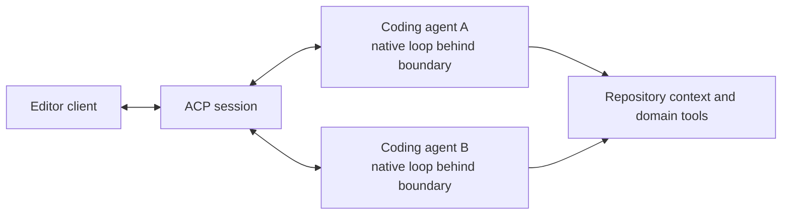

# 跨 Agent 宿主的模型原生语义

编码 agent 的操作语言是 worker 配置的一部分。模型通过后训练学习工具名称、模式、补丁语法、结果形状、错误和修复序列。[native computer-use example] 使这一点变得可见：一旦工具通过后训练集成到 worker 中，它就替代了定制的显示和视频管道。保留学习语义的宿主迁移可以在添加会话、权限、提供商选择、用户界面或传输的同时保留杠杆。

[native computer-use example]:
  https://www.aakashg.com/how-pms-ship-100k-lines-of-code/#:~:text=get%20to%20throw%20away%20all%20that%20bespoke%20code

迁移仍然创建了一个新的 worker 条件。语义保留降低了迁移风险；[Hold the Worker Constant] 要求新的 model-agent-host 组合再次通过完整的仓库旅程。

[Hold the Worker Constant]: README.md

## 将操作语言视为兼容性界面

兼容性不仅仅是有效的工具调用。比较：

- 哪些工具存在以及模型如何选择它们；
- 名称、描述和参数语法；
- 补丁匹配、原子性和部分失败；
- 结果形状、错误和省略细节检索；
- 熟悉的修复序列；
- 权限范围和批准选择；以及
- 时序、取消、压缩和会话行为。

即使是笨拙的接口，在大量使用后也可能变得可靠。用更干净的抽象替换它会消耗已学习的行为，必须通过更好的完成度、安全性或访问来证明该成本。

## 在每个迁移接缝处保留语义

多个保留接缝可以共存。宿主可以直接重用原生实现及其模型可见的语法。适配器可以在保留操作、结果、失败和权限行为的同时更改传输。客户端 agent 协议可以在携带客户端所需会话信息的同时保持编码 agent 的内部循环完整。

在任何这些接缝处都可能发生扁平化：包装器可以重命名操作、简化结果和错误、更改部分失败行为或合并权限选择。通过完整旅程来衡量由此产生的保真度。

## Polytoken 为活动模型选择工具

[Polytoken] 是一个面向多提供商的本地优先编码 agent 守护进程。其 [tool reference] 指出模型的编辑格式选择其编辑工具；面向补丁的模型接收 `patch_edit`。该设计在宿主添加本地会话、维度、子 agent、权限和 UI 的同时，保留了模型形状的编辑界面。

[Polytoken]: https://docs.polytoken.dev/introduction/
[tool reference]: https://docs.polytoken.dev/reference/tools/

Ryan 的 [Polytoken implementation observation] 记录了 Polytoken 直接重用 Codex 的开源 `apply_patch` 机制来实现该界面。公开的 [Codex `apply_patch` instructions] 暴露了提供给模型的宿主可见语法。重用原语将其补丁解析和应用语义带入新的宿主。Polytoken 仍然拥有其周围的批准、模型可见结果和部分失败行为；匹配的旅程必须覆盖这些接缝。

[Polytoken implementation observation]: ../../sources/ryan-notes.md
[Codex `apply_patch` instructions]:
  https://github.com/openai/codex/blob/main/codex-rs/core/prompt_with_apply_patch_instructions.md

这是服务于 harness engineering 的编码 agent engineering。团队可以选择 Polytoken 作为其 worker，保留已学习的原语，并将其部署工作集中在仓库上下文、领域工具、权限和证明上。

## ACP 将编码 agent 保持在传输边界之后

[Agent Client Protocol] 标准化了编辑器与编码 agent 进程之间的通信。编辑器启动或连接到 agent，而 agent 保持对其模型和工具循环的责任。ACP 协商能力，流式传输会话和工具调用更新，携带权限请求，并提供扩展字段和方法。

[Agent Client Protocol]:
  https://agentclientprotocol.com/get-started/architecture

这种分离可以在给予多个 agent 访问同一客户端的同时保留 agent 特定的行为。保真度取决于适配器。ACP 的核心 [tool-call representation] 包括原始输入和输出、进度、差异、终端输出和权限选择；其 [extension mechanisms] 允许实现协商额外行为。这两个特性都不能保证每个原生操作都能在最小公分母适配器中存活。

[tool-call representation]:
  https://agentclientprotocol.com/protocol/v1/tool-calls
[extension mechanisms]:
  https://agentclientprotocol.com/protocol/v1/extensibility

当适配器重命名熟悉的操作、隐藏结构化错误、更改编辑原子性、减少权限选择或抑制所选 agent 需要的扩展时，它会丢失有用的保真度。带有协商扩展的公共核心支持互操作性，而不需要每个 agent 以相同方式运行。

## 评估完整迁移

在宿主或操作语言更改前后运行匹配的仓库旅程。衡量接受的结果、人类干预、语义编辑失败、修复循环、权限精度、证据质量、延迟和运营成本。包括部分失败和取消，因为传输差异通常在此处变得可见。

保留帮助 worker 完成工作的已学习语义。当匹配的旅程在考虑迁移和修复成本后显示更好的完成度、安全性或环境访问时，采用更改的界面。
