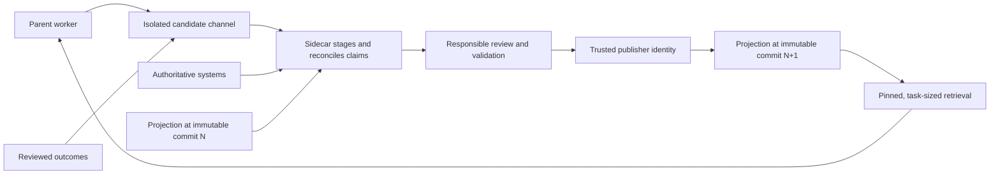

# 按需路由 Context

持久知识可以远大于 agent 的活跃工作集。让更大的环境保持可搜索，告诉 worker 存在哪些类型的 context 以及在哪里找到它们，让任务自行拉取下一个相关切片。harness 通过使检索在长轨迹和重复 compaction 中保持可靠来管理注意力。

[Disk is an infinite context sink] 描述了底层策略：外化状态，检查有界预览，让 agent 使用代码选择其余部分。本地磁盘是一个持久的、可搜索的工作存储。挂载的语料库和连接器使其他权威来源可寻址，无需转移其所有权。目标仓库检索相关切片并维护其本地契约和路由。

[Disk is an infinite context sink]:
  https://x.com/_lopopolo/status/2042702983893229946

更大的 context window 减轻了容量压力。注意力、检索质量、冲突的指导方针，以及决定当前步骤中哪个事实更重要，仍然是稀缺资源。[Deterministic context stuffing fails] 表明一旦工作跨越多次 compaction；worker 必须能够再次恢复路由。

[Deterministic context stuffing fails]:
  https://x.com/_lopopolo/status/2062966895876215172

[The two-part context economy] 将非功能性需求放在一个可以被拉入 context 的空间中，然后最小化应用它们所需的 context。[Domain modeling] 为每个需求提供持久的所有者和表示。按需路由在任务到达其管辖的决策点时选择相关切片。

[The two-part context economy]:
  https://x.com/_lopopolo/status/2030356581792293212
[Domain modeling]:
  ../domain-modeling/#make-nonfunctional-requirements-recoverable

## 跨不同知识层路由

不同的知识体系通过不同的接口进入轨迹。

| 层级                 | 内容                                                                                                                             | Agent 接口                                                     |
| -------------------- | -------------------------------------------------------------------------------------------------------------------------------- | -------------------------------------------------------------- |
| 权威系统             | 当前记录、事件、权限和运营历史                                                                                                   | 搜索、连接器、查询和有界工具                                   |
| 共享 context 存储    | 精选的跨项目本体论、运营原则和保留实时所有者链接的源路由                                                                         | 挂载的语料库、搜索或知识服务                                   |
| 目标仓库             | 本地架构、schema、决策、关键旅程、运维手册、防护栏和源路由                                                                       | 文件、嵌套指导、搜索、命令和失败检查                           |
| 活跃 context         | 任务、当前观察、计划、证明、未解决的决策，以及从其他层为当前运行选择的切片                                                       | Prompt、检索结果、工具输出和摘要                                |

[Deploy Into the Private Process-Data Iceberg] 阐述了为什么运营和组织知识将权威所有者保留在产品仓库之外。按需路由为一个任务组合这些来源，并将更大的语料库保留在原处。

[Deploy Into the Private Process-Data Iceberg]: ../last-mile-deployment/

## 在每个目标旁策划路由

将一个承载目标的父 worker 与一个 [context sidecar] 配对：一个单独的 worker，持续管理小型 Git 仓库，供父 worker grep 和搜索。父 worker 拥有结果。sidecar 维护该目标的 context 投影。

[context sidecar]:
  https://tessl.io/podcast/109/#:~:text=potentially%20give%20each%20agent%20in%20your%20enterprise%20sort%20of%20a%20sidecar,little%20git%20repositories%20that%20they%20can%20grep%20and%20search%20over

发布将观察与批准用于后续工作的 context 分开。父 worker 将问题、检索失败、未解决的术语、结果证据和其他 context 缺口发出到一个与父 worker 的检索树隔离的候选通道中。`MISTAKES.md`、`LEARNINGS.md` 和 `DESIRES.md` 是 [harness 构建者的 agent 发出的遥测数据]。在将这些自我报告发布为 context 之前，需要进行交叉验证。

[agent-emitted telemetry for the harness builder]:
  https://x.com/_lopopolo/status/2037307669464363433

已完成的工作仍然是候选内容的丰富来源。Aakash Gupta 的采访描述了一个 [采访用户并从已完成任务中学习的 context 库]。Latent Space 的采访另外描述了 [收集 agent 轨迹并提炼团队知识库]。已审核的工作为相同的协调路径提供候选内容。sidecar 暂存并协调这些观察；负责的领域所有者批准编码了判断或策略的 context。

[context library that interviews users and learns from completed tasks]:
  https://www.aakashg.com/how-pms-ship-100k-lines-of-code/#:~:text=a%20library%20with%20the%20ability%20to%20both%20interview%20the%20user%20and%20learn%20from%20all%20the%20tasks
[collecting agent trajectories and distilling a team knowledge base]:
  https://www.latent.space/p/harness-eng#:~:text=we%E2%80%99re%20collecting%20all%20the%20agent%20trajectories%20from%20Codex%20to%20slurp%20them%20up%20and%20distill%20them

候选材料不受信任，被排除在父 worker 的检索路径之外。它不能直接触发发布。策展人在一个隔离的暂存区域中提出 claim-and-evidence diff，保留来源、分类和受众元数据。敏感材料保留在其权威所有者处。发布策略指定负责的审查者、验证器可以接受的机械更新，以及允许发布的独立身份。

Ryan 的私有 homelab 仓库提供了一个更窄的类似物，用于 [定时文档新鲜度角色]。仓库级别的角色将运维文档与定义当前行为的配置和监控文件进行比较。一个发现必须指出过时的页面、与之矛盾的本地证据、具体的编辑以及任何未解决的判断。默认情况下它仅限报告；有人明确授权才会进行改变仓库的后续操作。

[scheduled documentation-freshness role]:
  ../domain-modeling/homelab.md#keep-operational-docs-current

提议的目标 sidecar 增加了隔离的暂存和发布边界。反馈既改变其策展人，也改变其投影。人类对候选报告的回应、pull-request 审查和失败的验证会更新 sidecar 的版本化契约。它自己的评论带有稳定的标记，被排除在人类反馈通道之外。这种区分防止策展人将之前的输出视为独立监督，同时仍然让实际结果改善后续的扫描。

策展人将每个候选与权威来源和当前发布的投影进行协调。它记录来源、新鲜度、受众和未解决的矛盾。被接受的更改作为原子提交发布。轨迹中读取的每个投影都通过一个不可变的提交哈希来解析。常规刷新在轨迹之间采用新的哈希；强制的运行中刷新创建一个显式的阶段边界，并记录新旧哈希。默认情况下，实时查询结果保留在固定投影之外。当来源、受众和保留策略允许时，经过审查的有界快照可以进入。Aakash Gupta 采访中的维护文档系统同样 [记录指导当前有效的仓库修订] 并 [在指导变得无关时将其归档]。

[records the repository revision where guidance is current]:
  https://www.aakashg.com/how-pms-ship-100k-lines-of-code/#:~:text=They%20embed%20git%20repository%20revisions%20of%20when%20they%20are%20current%20as%20of
[archives guidance when it becomes irrelevant]:
  https://www.aakashg.com/how-pms-ship-100k-lines-of-code/#:~:text=They%E2%80%99re%20sunset%20and%20archived%20when%20they%20become%20irrelevant%20or%20features%20get%20removed

定时刷新处理已知的波动性。当当前决策依赖于更新的状态时，父请求可以强制进行新鲜度检查。父 worker 仍然选择工作所需的路由和切片。[garden the Git repositories used to bootstrap tasks] 的 agent 是自动化仓库维护的一个相邻示例。

[garden the Git repositories used to bootstrap tasks]:
  https://www.aakashg.com/how-pms-ship-100k-lines-of-code/#:~:text=Things%20that%20garden%20the%20individual%20git%20repositories%20that%20are%20used%20to%20bootstrap%20all%20the%20tasks

发布契约使失败变得可读：

| 条件                   | 策展人行为                                                                                                                     |
| ---------------------- | ------------------------------------------------------------------------------------------------------------------------------ |
| 过时的路由             | 标记其最后已知的修订，并在将其作为当前内容提供之前从实时所有者处检索                                                           |
| 矛盾的来源             | 保留冲突并将其路由到能够解决冲突的所有者                                                                                       |
| 不可用的来源           | 报告来源不可用，并将之前的副本标记为历史                                                                                       |
| 过多的 context         | 改善索引和检索路由；保持提供的切片为任务规模                                                                                   |
| 策展延迟               | 提供最后发布的修订，并报告候选队列状态而不暴露候选内容                                                                         |
| 权限不足               | 返回显式的访问缺口，并将材料保留在其权威所有者处                                                                               |
| 被破坏的发布           | 撤销受信任的引用，隔离该修订，恢复最后已知良好的哈希，并通知受影响的父轨迹                                                     |

新会话测试测试父 worker 是否检索并应用新路由。消融测试测试 context 更改是否导致了改进，已审核的任务结果决定更改是否继续发布。跟踪检索频率、仓库大小和提交计数作为运营信号；根据任务结果判断成功。活跃窗口仅接收当前决策所需的切片，而持久的提交使后续轨迹能够在 compaction 后恢复路由。

sidecar 是一个具有自身行为的 harness 组件。对其选择的模型和 agent、prompt、工具和权限进行版本控制。在每次发布时记录产生该发布的配置，并在该配置更改时重新验证策展路径。

[Pair Each Goal With a Context Curator] 阐述了部署边界、投影所有权和生命周期。

[Pair Each Goal With a Context Curator]:
  ../last-mile-deployment/#pair-each-goal-with-a-context-curator

## 使用 `AGENTS.md` 作为地图

根指南应包含：

- 仓库是什么以及哪些兼容性表面重要；
- 所有工作预期的运营循环；
- 一小批任务类别或黄金路径；以及
- 指向每个类别对应的领域文档、命令和证明的链接。

架构、依赖态势、生成契约、运维手册和领域决策属于它们管辖的工作旁边。嵌套指南在 worker 进入包或领域时收窄路由。[task-oriented repository maintenance layout] 可以将该地图与人类入职、持久自动化运维手册以及从项目历史中恢复的防护栏配对。

[task-oriented repository maintenance layout]:
  https://x.com/_lopopolo/status/2060767456302428343

[canonical harness-engineering essay] 描述了一个变得太大而无法使用的单体 agent 手册。一个简短的根目录加上索引的设计文档、产品规格、执行计划和参考文献，使渐进式披露成为一个拥有的仓库功能。链接和新鲜度检查保持这些路由的可信度。

[canonical harness-engineering essay]:
  https://openai.com/index/harness-engineering/#:~:text=give%20Codex%20a%20map%2C%20not%20a%201%2C000-page%20instruction%20manual

## 分三个阶段交付 context

[AI Native DevCon talk] 阐述了一个运营轨迹，在其中 context 在接地阶段、混乱的中间阶段以及审查和着陆阶段到达。

[AI Native DevCon talk]:
  https://tessl.io/registry/ainativedev/aidevcon-2026-ldn/0.100.8/files/talk-lopopolo-harness-engineering/transcript.md#:~:text=three%20phases%20I%20think%20about%20when%20we%27re%20talking%20about%20context%20delivery

### 接地阶段

从简洁的地图开始：任务类别、相关架构和决策、关键旅程，以及建立当前状态的命令。worker 应理解它正在改变什么以及在哪里查看，同时保留通往更深层来源的路由。

### 混乱的中间阶段

让代码、工具输出、测试失败、浏览器状态、日志和诊断揭示下一个 context。错误应指出违反的不变量和可能的修复方法。这个阶段是探索性的；固定的步骤列表无法预测每个分支。

### 审查和着陆阶段

在工件具有稳定形状后，重新应用特定角色的审查者、验收标准、证明要求和交付策略。结果标准和关键旅程从接地阶段开始就保持可见；着陆将它们的详细审查视角带回已完成的工件。将轨迹压缩为一个决策就绪的数据包，供人类直接审查。

这种时序保持全局 context 较小，并在可能改变决策的地方呈现具体性。

## 让 worker 发现下一层

文件、搜索、普通 CLI、`--help` 和有界结构化输出是强大的 context 接口，因为模型已经知道如何探索它们。工具描述应说明存在什么能力以及它为什么重要。更深层的 schema、示例或手册可以在 worker 选择它后加载。

指导应 [为寻求 context 设定期望]：worker 正在做什么，为什么重要，要寻找什么类型的材料，以及可用工具如何暴露它们。然后 agent 可以在任务和活跃窗口变化时推理本地路由。

[set expectations for seeking context]:
  https://x.com/_lopopolo/status/2062950475989725465

工具输出是特定阶段的 context。[Make Capabilities Legible and Operable] 阐述了安静的成功、有界的结果、可操作的错误和修复提示。

在长的 Codex 轨迹中，这种放置也影响 compaction。高信号的用户意图可以保持影响力，而较旧的工具结果被摘要化或丢弃。在决策点通过仓库读取、诊断和工具输出呈现窄指导，然后依赖持久路由再次检索它。保持用户消息聚焦于结果、验收标准和应在整个工作中存活的权威。确切的保留策略属于所选的 worker，并且必须在该 worker 更改时重新验证。

[Make Capabilities Legible and Operable]: ../tool-legibility/

## 将 context 放在最迟的可靠点

每条全局指令都消耗注意力并收窄 worker 的选择。在 agent 可以可靠地检索和应用判断时，将判断保持在可发现的散文中。使用特定阶段的审查者和检查，仅在工件或操作使其相关时呈现更窄的指导。

反复的遗漏、重大的风险或跨越 compaction 的检索失败表明规则需要更强的放置。[Turn Feedback Into Infrastructure] 负责该提升决策以及从晚期指导到持久控制的进展。

[Turn Feedback Into Infrastructure]: ../feedback/

## 用 skill 教授，用 runbook 保留工作

一个 skill [teaches an approach to the job]。它的描述宣传 [what the skill is and why it might matter]，当轨迹需要它们时加载完整的说明。长的命令式 skill 可能过拟合一条路径，使 worker 拒绝合理的例外。

[teaches an approach to the job]:
  https://x.com/_lopopolo/status/2063148351885918623
[what the skill is and why it might matter]:
  https://x.com/_lopopolo/status/2077149347528261712

仓库可以在 agent 扫描的位置之外保持广泛的 skill 库。一个 gitignored 链接区域可以为一个轨迹暴露 [small task-relevant set]，允许许多贡献者签入专业 skill 而无需为每个 worker 加载所有 skill。团队仍然可以通过反复使用和改进来收敛到共享的核心。

[small task-relevant set]: https://x.com/_lopopolo/status/2077306653540749667

runbook 是可重复工作的版本化契约。它记录意图、前置条件、步骤、安全边界、证据、升级和回滚。自动化可以通过指向仓库拥有的 runbook 来保持精简。

[Enabling Codex to Upgrade My Robot Vacuum] 在一个重要的维护工作中展示了两个边界。定时 prompt 路由到一个签入的自动化契约，该契约拥有候选选择和仅构建的权限。一个单独的部署 runbook 拥有金丝雀和生产阶段。持久的工作位于工具和安全边界旁边，供人类和 agent 审查。

[Enabling Codex to Upgrade My Robot Vacuum]:
  https://hyperbo.la/w/robot-vacuum-canary-tailscale/#:~:text=The%20repo%20carries%20the%20durable%20instructions

## 维护路由和语料库

context 路由有持有成本。保持交叉链接可机器检查，在读者需要的地方记录所有权和新鲜度，并用规范的后续或显式的墓碑替换过时的路由。

[Test a curated knowledge base in a fresh session] 以了解 worker 是否检索到正确的来源并改变其行为。文档的存在仅证明它被编写过。[Feedback infrastructure] 负责消融和提炼；[Run Known Work as a Continuous Loop] 阐述了反复的维护和退役。

[Test a curated knowledge base in a fresh session]:
  https://x.com/_lopopolo/status/2048944585486012775
[Feedback infrastructure]: ../feedback/
[Run Known Work as a Continuous Loop]: ../continuous-maintenance/
