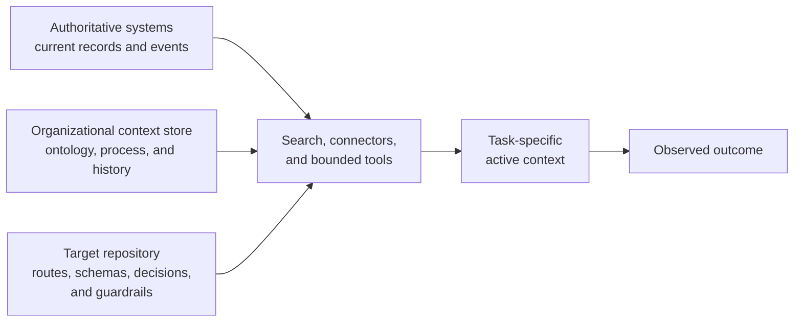
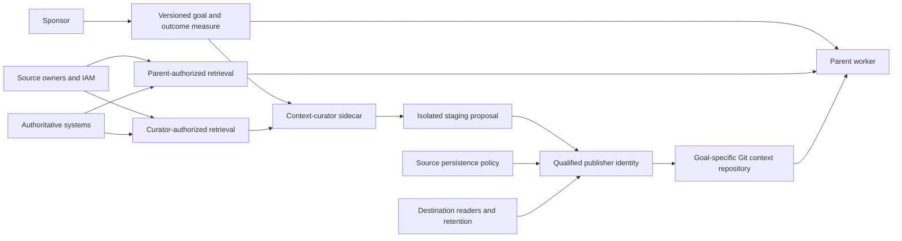

# 部署到私有流程-数据冰山

通用模型权重包含了组织知识的可见冰山一角。工作本身依赖于更大的、潜藏在水下的私有、变化的流程数据：当前记录、本地本体论、运营历史、工作流异常、隐含的质量标准和权限关系。[The model does not have your data]，组织不能假设这些材料会存在于通用模型权重中，也不能假设 agent 会可靠地推断出哪些部分管辖特定的工作。最后一英里部署使相关的关系和能力可供为部署保持不变的选定模型-编码 agent 配置使用。

[the model does not have your data]:
  https://x.com/_lopopolo/status/2051086282236068178

由此产生的 worker 可以执行一项有位置感的工作。它知道公司使用的收入定义是哪个、哪个客户处于试点中、调查通常如何进行、团队接受什么水平的打磨，以及哪个人可以授权下一步。

## 发现部署表面

[Please Go Brr, on Token Mandates] 将广泛的 token 预算视为一种组织搜索策略。领导层很少事先知道哪些从业者可以塑造有效的 harness、哪些业务问题可以吸收推理计算，或者哪些 context、工具和访问的组合会奏效。分布式实验让组织现有的专家在工作附近发现这些模式。

[Please Go Brr, on Token Mandates]:
  https://hyperbo.la/w/token-mandates/#:~:text=organizational%20discovery%20mechanism%20for%20learning%20how%20to%20deploy%20reasoning%20compute

一个有用的实验识别出一项有位置感的工作、理解它的人、缺失的 context、工具或访问权限，以及关于结果的证据。这些发现可以成为共享 context、铺设好的环境和有界工具。[Outcome-bound effectiveness] 决定哪些模式值得持续投资。

[Outcome-bound effectiveness]: ../effectiveness/

## 围绕记录建模工作

一个有用的组织 context 存储保留赋予记录意义的概念。它的数据本体论命名实体、指标、标识符及其关系。它的工作本体论命名结果、工作流、参与者、工具、异常、证据和权限。这些模型为当前运营状态提供可解释的关系。

[business-ontology example] 通过一个内部数据 agent 使这变得具体。仅靠仓库访问无法解决收入的矛盾定义或活跃用户。agent 还需要公司的产品线、客户细分、团队、试点客户、当前计划和共享指标定义。这些关系让它能够推理业务如何运作，并产生属于该组织的答案。

[business-ontology example]:
  https://www.latent.space/p/harness-eng#:~:text=You%20have%20to%20understand%20what%20revenue%20is%2C%20what%20your%20customer%20segments%20are

[How PMs Ship 100K Lines of Code] 描述了积累该语义层的产品形式。一个可重用的 context 库就数据本体论和业务指标采访用户，从已完成的任务中学习，并使产生的持久知识可供后续运行使用。领域专家可以通过工作本身来培训部署的 worker。

[How PMs Ship 100K Lines of Code]:
  https://www.aakashg.com/how-pms-ship-100k-lines-of-code/#:~:text=both%20interview%20the%20user%20and%20learn%20from%20all%20the%20tasks

组织特定的非功能性需求属于同一个工作模型。[What Does It Mean to Do a Good Job?] 命名了团队通常通过招聘和反复接触传递的基调、品味、风险容忍度、可接受的捷径和打磨程度。这些选择随组织、产品和风险态势而变化，使其成为有位置感的工作所需的私有流程数据的一部分。它们的显式形式将通用模型的许多看似合理的专家风格转变为一个当前的本地标准。

[What Does It Mean to Do a Good Job?]:
  https://hyperbo.la/w/what-does-it-mean-to-do-a-good-job/#:~:text=tone%2C%20taste%2C%20risk%20tolerance%2C%20how%20much%20polish%20is%20enough%2C%20what%20shortcuts%20are%20acceptable

## 让每种真相与其所有者在一起

当前记录属于已经拥有其权限、历史和更新路径的系统：数据仓库、问题跟踪器、文档系统、日志、源代码仓库、客户系统和运营数据库。搜索和连接器可以在不创建第二个过时副本的情况下检索授权的切片。

组织范围的 context 可能需要一个单独的托管语料库。其所有者维护权利、保留、新鲜度和访问权限，而目标仓库保留更改和验证其自身系统所需的架构、schema、决策和防护栏。

目标仓库拥有更改和验证该目标所需的知识：架构、schema、关键旅程、本地决策、防护栏和通往权威来源的路由。当存在更广泛的 context 存储时，其所有者维护语料库的权利、保留、新鲜度和访问模型。活跃轨迹接收跨这些来源的最小相关投影。

这个边界使产品仓库保持专注且可审查。整个语料库的快照需要一个明确的所有者来负责来源、权限、时效、保留和删除。实际的更改通过拥有受影响状态的系统写入；经过审查的稳定教训返回负责其未来使用的所有者。[Route Context Just in Time] 阐述了 agent 如何在不将所有层都加载到其工作集的情况下跨越这些层。

[Route Context Just in Time]: ../just-in-time-context/

## 将每个目标与一个 context 策展人配对

在 [Basis's context repositories in OpenAI Build Hour] 中，Mitch Troyanovsky 描述了 `Arnold`（生产 monorepo）和 `Atlas`（生产树之外的公司 context 的第二个 Git 仓库）。Codex 可以组合个人笔记、公司运营知识和生产代码，而这些信息体保留独立的更新路径。

[Basis's context repositories in OpenAI Build Hour]:
  https://rewiz.app/channels/%40openai/build-hour-api-codex#:~:text=we%20have%20two%20repos%20in%20our%20company

将目标作为部署单元。其发起人——对结果负责的个人或团队——定义目标版本、结果度量、请求的系统和范围，以及触发修订的条件。目标指导一个父 worker：一个在其 harness 中运行的选定模型-编码 agent 对。Ryan Lopopolo 写道，[`/goal` is for processes and outcomes]：一个目标可以驱动多个工作单元，并产生多个 pull request 或工件。context 策展人 sidecar 维护为该持续目的选择的组织 context。

[`/goal` is for processes and outcomes]:
  https://x.com/_lopopolo/status/2051758630312280085

sidecar 可以在目标下记录变化的工作、当前阶段和 context 缺口。发起人拥有目标本身的更改。每个重要的目标修订都会创建一个新版本，并触发 context 投影、权限和结果度量的重新验证。

目标特定的仓库是一个派生的投影。它持有路由、目标范围的综合、决策、示例、来源和有界快照。易变的记录保留在实时系统中。将目标规则提交给目标仓库的所有者，将可重用的组织范围知识提交给共享语料库的所有者。仅为目标存在的 context 随目标到期而过期。

父 worker、策展人和发布者使用不同的身份并接收单独的授权。发布需要来源所有者的持久化权限、与目标仓库读者的兼容性、分类、存储和保留策略，以及供指定父 worker 读取结果的权限。策展人更广泛的来源访问不能扩大父 worker 的范围。仅在这些条件对齐时才快照材料；为其他所有内容保留实时路由。密钥和凭据材料不进入仓库。Git 作者元数据记录更改历史而不建立身份或权限。

一个包含 Markdown 和小型结构化文件的 Git 仓库就足以实现这个持久的、文本形状的投影。编码 agent 已经知道如何搜索、读取、比较和修补它。实现可以是 ["just Codex and a Git repo full of Markdown"]。仓库托管添加了审查和访问控制，而显式的引用保留了来源来源。

["just Codex and a Git repo full of Markdown"]:
  https://x.com/_lopopolo/status/2063119284084023805

Bootstrap 记录了发起人、目标版本、worker 身份、经过验证的父 worker 和 sidecar 配置、权威系统、目标受众和保留策略，以及初始源路由。当目标结束时，停止计划的工作并撤销 sidecar 的凭据。来源所有者和适用策略决定仅限目标的 context 是被归档还是被销毁。删除提交不会擦除 Git 历史。有保证的删除还涉及仓库历史和受控的缓存、克隆和下游副本。具有严格删除义务的材料在投影之外保持为实时引用。

[Route Context Just in Time] 负责该投影的策展、发布、服务和评估循环。

## 将稳定决策提升到其所有者

一些运营对话产生应该比对话线程更持久的决策。决策属于其管辖未来工作的层。在 [cryptography example in OpenAI Build Hour] 中，一个内部 OpenAI 产品团队与安全合作选择了一个批准的加密实现。该决策留在 Slack 中，因此一个使用 Codex 的新工程师添加了一个不同的 npm 加密依赖项。团队恢复了该决策，并编码了一个仓库防护栏，要求使用批准的实现并禁止替代的 npm 加密包，然后重新运行了更改。将范围规则编码在仓库中使其可供未来的更改使用，而 Slack 保留了决策历史。

[cryptography example in OpenAI Build Hour]:
  https://rewiz.app/channels/%40openai/build-hour-api-codex#:~:text=I%20partnered%20with%20our%20security%20engineering%20team%20to%20upgrade%20our%20app%20to%20the%20blessed%20cryptography%20library

提升需要判断。记录决策的范围、所有者、生效日期或替代条件，以及执行表面。当它有助于解释选择时，保留指向原始证据的链接。将易变的事实留在其权威系统中，并在任务需要时检索它们。

[Turn Feedback Into Infrastructure] 阐述了反复的更正和失败的轨迹如何成为持久的控制。

[Turn Feedback Into Infrastructure]: ../feedback/

## 同时暴露 context 和能力

harness engineering 通过两个耦合的表面呈现私有流程数据：

- 可检索的 context，解释领域、当前状态、意图和约束；以及
- 有界工具，让 worker 在流程所在的地方进行检查和操作。

Ryan 的公理 [code is how an agent uses a computer] 命名了 worker 的内部操作语言。编码 agent 可以搜索文件、查询系统、转换格式、调用 API、检查接口、产生工件和验证结果。代码可以留在 worker 的执行路径内，而用户获得领域结果。

[code is how an agent uses a computer]:
  https://x.com/_lopopolo/status/2043495733375230026

这改变了稀缺专业知识的分配方式。数据团队传统上将其杠杆编码到预期常见问题的黄金表和仪表板中。一个拥有团队数据本体论和业务 context 的 agent 可以 [deliver the bespoke service directly]，产生当前用户需要的答案或工件。同样的做法适用于调查、支持工作流、财务分析、研究、行政管理和其他专家工作。

[deliver the bespoke service directly]:
  https://x.com/_lopopolo/status/2049939343901606332

## 为领域专家提供铺设好的车道

领域专家已经知道他们工作的困难部分。[Coding Agents for Technical Non-Engineers] 展示了托管环境如何让他们编码：标准化语言和打包工作流、使运行时与端点安全兼容、通过企业配置分发 agent 指导，以及提供小型批准的常见转换工具包。科学家、分析师、运营人员、支持人员和安全研究员可以将调查或重复性任务转化为可审查、可重复的工件。

[Coding Agents for Technical Non-Engineers]:
  https://hyperbo.la/w/coding-agents-for-technical-non-engineers/#:~:text=Domain%20experts%20already%20have%20the%20hard%20part

铺设好的车道还为 worker 提供了回到专家的有界路由。在 [Code Is Free] 中，worker 识别负责安全假设的人，解释为什么该假设可能不再成立，并提出仓库无法回答的确切问题。专家保留决策权限；harness 保留答案的来源和范围。[Accrue Domain Expertise Through the Work] 阐述了经过审查的答案如何成为持久的 context 和可执行的防护栏。

[Code Is Free]: https://www.youtube.com/watch?v=U2O14Jd3MBU&t=395s
[Accrue Domain Expertise Through the Work]:
  ../feedback/#accrue-domain-expertise-through-the-work

## 服务从未见过代码的用户

塑造 harness 的领域专家和使用其服务的最终用户是不同的角色。科学家或分析师可能检查并保留一个可重复的脚本。支持专员、高管或客户可能只使用领域请求和产生的数据集、调查报告、演示文稿、决策包、完成的工作流或应用程序。Ryan 认为 [not everyone needs to know about or see the code]；体验将他们的问题转化为 agent 可以良好执行的工作。

[not everyone needs to know about or see the code]:
  https://x.com/_lopopolo/status/2047037215864418486

用户应该能够在领域术语中验证结果。边界暴露与声明适当的控制：来源结论的来源、重要变更的预览和批准、已交付输出的工件身份，以及已完成工作流的观察后条件。[coherence loop] 让接受和失败的领域工件改善后续用户的 context、工具、边界和检查。由此产生的 [proof in the user's domain] 不要求用户审查中间程序。

[coherence loop]: ../durable-systems/#make-coherence-cumulative
[proof in the user's domain]: ../proof/

## 衡量有位置感的有效性

当 worker 能够使用组织的当前知识、质量标准和权限完成有价值的工作时，部署就成功了。语料库大小和工具数量是输入。相关的度量是结果质量、人类注意力、延迟、风险和维护负担。

经济机会在于 [putting the model in position to do the work]。该位置针对客户的知识、工作流、环境和权限是特定的，这使得周围的部署系统成为产品的一部分。

[putting the model in position to do the work]:
  https://x.com/_lopopolo/status/2031963382929375432

[Optimize for Measured Effectiveness] 阐述了评估边界。

[Optimize for Measured Effectiveness]: ../effectiveness/
