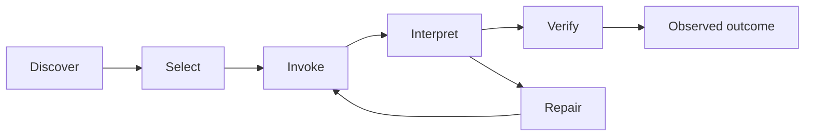

# 使能力可读和可操作

当 worker 能够在需要时发现能力、识别其何时适用、正确调用它、解释有界结果、从失败中恢复并在真实系统中验证其效果时，能力就变得可用。该循环中的每条边都向轨迹贡献 context。

## 使发现和熟悉度协同工作

动态或不熟悉的能力需要一个紧凑的、模型可见的目录：一个有意义的名称、目的、输入形状、结果形状和第一个有用的调用。[tool-discovery contract] 将此接口阐述为由实时服务器交付的 token。skill、仓库路由、CLI 帮助和原生应用功能可以暴露相同的要素。

[tool-discovery contract]:
  https://hyperbo.la/w/tool-discovery/#:~:text=names%2C%20descriptions%2C%20input%20schemas%2C%20and%20example%20calls

熟悉度是一个单独的轴。POSIX 命令可以利用强学习先验，但在 worker 知道它已安装之前仍然不可见。Model Context Protocol (MCP) 服务器可以立即宣传命名的工具及其输入 schema，而模型可能仍然必须学习每个新颖的调用和结果形状。Ryan Lopopolo 的 [CLI and MCP comparison] 和 [familiar POSIX CLI] 论述使这种权衡变得明确。

[CLI and MCP comparison]: https://x.com/_lopopolo/status/2031821445454876896
[familiar POSIX CLI]: https://x.com/_lopopolo/status/2031834223930458283

两者都使用渐进式披露。简洁地宣传什么和为什么。在选择后加载详细的 schema、示例或手册。当熟悉的命令干净地完成工作时保留它们；当新表面添加领域能力、暴露否则不可达的状态、缩小权限、减少 context 成本或提供可靠验证时引入它。

[Electron tool-transport migration] 使此兼容性边界变得具体。Codex 需要通过 Chrome DevTools Protocol 连接到团队的 Electron 应用。第一个接口通过 MCP 暴露该连接。一位队友后来用本地 TypeScript 守护进程和一个小型 CLI 替换了它，因为 worker 仅需要两三个操作。迁移后，Codex 仍然通过那小组 Chrome-DevTools 支持的操作访问 Electron 应用，Ryan 的工作流在没有中断的情况下继续。端到端旅程测试应保护该行为契约跨越未来的传输更改。

[Electron tool-transport migration]:
  https://tessl.io/podcast/109/#:~:text=completely%20replaced%20the%20MCP%20connection%20in%20his%20codebase%20with%20a%20TypeScript%20daemon

## 将每个结果设计为 context

worker 必须从成功输出、结构化结果、错误、日志和修复提示中决定发生了什么以及下一步做什么。有用的工具行为包括：

- 安静的成功；
- 结果将被机械检查时的有界、稳定结构；
- 失败时的违反不变量和受影响目标；
- 存在时的已知恢复操作；
- 省略细节的检索路径；
- 重要影响的检查或演练模式；以及
- 后条件查询或副作用收据。

[failure-only tool output] 描述了抑制通过噪声并暴露失败部分的格式化器和测试。抑制属于工具边界。工具运行完整的工作，保留其完整的输出和真实退出状态，返回下一个决策所需的有界结果，并为省略的证据提供稳定的路由。

一个 context 不安全的测试命令创建可识别的失败签名：worker 先发制人地将昂贵的命令（如 `cargo test`）通过 `head` 或 `tail` 管道传输。`head` 可以关闭管道并在完成前终止测试进程。`tail` 通常读取到完成但丢弃较早的证据。没有管道状态处理时，任一过滤器也可以隐藏测试进程的退出状态。当后期失败依赖于较早的 context 时，丢弃的输出不可用。仓库拥有的包装器或测试报告器应完整运行一次作业，保留其真实状态和完整输出，返回语义失败摘要，并使底层证据可查询而无需重新运行测试。

[failure-only tool output]:
  https://www.latent.space/p/harness-eng#:~:text=only%20output%20the%20failing%20parts%20of%20the%20tests

## 暴露完成工作的最小接口

原生命令在模型经验中已代表的能力上工作良好。领域工具在使不可访问的系统可寻址或将重复的操作力学压缩为工作实际使用的概念时赢得其位置。已学习工具的替换主机应保留其操作名称、参数和结果形状、错误、审批行为、取消和生命周期语义。CLI、MCP 和其他适配器应在拥有这些概念的类型化包之上保持精简，使每个表面调用相同的策略而非实现并行的领域模型。

[model-native semantics note] 阐述了 worker 的已学习工具和主机之间的兼容性表面。[Make the Repository Teach the Agent] 阐述了类型化的能力边界和规范所有权。

[model-native semantics note]: ../fixed-worker/model-native-semantics.md
[Make the Repository Teach the Agent]: ../domain-modeling/

## 下降到缺失的原语

whole-job 委托从外到内揭示能力。从期望的结果开始。当工作遇到不可用的原语时，将该原语视为一个嵌套的 whole-job。worker 或 harness 构建者可以沿着依赖链下降，构建或导入最小的持久能力，然后返回到原始结果。

[credential-management recursion] 中的原始目标是让 Codex 读取 Slack 并识别入站故障，而无需人将消息复制到轨迹中。Slack 访问需要凭据管理；worker 需要一个请求凭据的接口；该接口需要密钥链访问和围绕敏感材料的安全编码约束。Ryan 描述这种能力搜索递归六到八层。一旦此搜索达到可用的原语，团队就回溯到故障分类。每个导入的能力扩展了未来 worker 可以完成的工作。

[credential-management recursion]:
  https://www.aakashg.com/how-pms-ship-100k-lines-of-code/#:~:text=the%20thing%20I%20have%20to%20build%20first%20is%20like%20credential%20management

这个递归路径也是反馈。缺失的边标识了一个持久的环境改善。一个一次性的中继为下一个轨迹留下相同的能力缺口。

## 给 worker 真实的系统

可操作性跨越应用、浏览器和 DOM、日志、分析、指标、跟踪、源数据、问题跟踪器、审查、CI、部署准备和证明工件。[Agent Utilization Is the New Performance Ceiling] 盘点了整个生命周期。OpenAI 的 [worktree-local application loop] 展示了应用实例、浏览器控制和可观测性关闭一个真实的应用循环。

[Agent Utilization Is the New Performance Ceiling]:
  https://hyperbo.la/w/agents-agents-agents/#:~:text=Most%20of%20the%20software%20lifecycle%20is%20reading%20logs
[worktree-local application loop]:
  https://openai.com/index/harness-engineering/#:~:text=we%20made%20the%20app%20bootable%20per%20git%20worktree

让 worker 启动和检测自己的环境。人工中继增加延迟并剥离诊断所需的状态。当 worker 能够观察其后条件、检索相关证据并修复或回滚失败尝试时，能力就完成了。

[Electron component workbench] 在 UI 系统中展示了此边界：生产设计系统组件形成操作表面，而 DevTools、运行时遥测、语义状态和光栅化输出使结果可观察。

[Electron component workbench]:
  ../proof/#give-the-agent-access-to-the-real-system

能力不授予权限。[Maximize Autonomy Inside Explicit Authority] 定义了围绕重要影响的身份、范围、生命周期、审批、审计、撤销和恢复契约。

[Maximize Autonomy Inside Explicit Authority]: ../authority/
