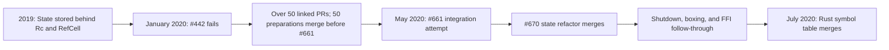
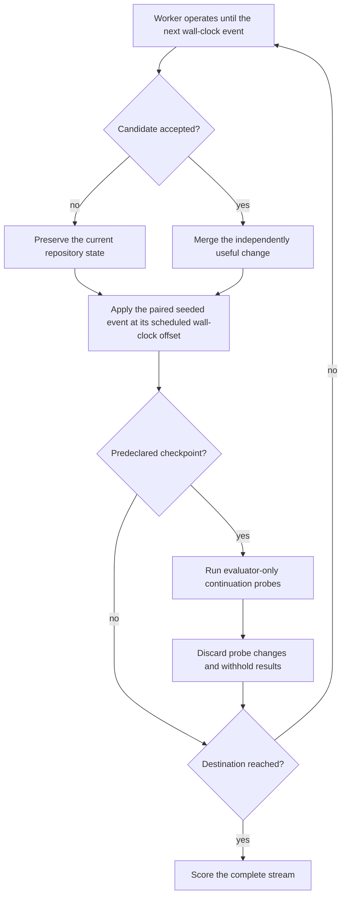

# Future Regret in Artichoke's State Refactor

Artichoke 是一个用 Rust 构建的 Ruby 实现，围绕 mruby（一个用 C 编写的 Ruby 虚拟机）。Rust 拥有的解释器状态跨越到 C 调用中，而这些 C 调用可能回调到 Rust，同时 mruby 的垃圾收集器在运行。2020 年，Artichoke 将该状态存储在 `Rc<RefCell<State>>` 后面：`Rc` 提供共享所有权，而 `RefCell` 在运行时检查借用，而非通过普通的 Rust 编译时规则。

该包装器阻止了状态组件的独立借用。同时，Ruby 核心和标准库实现通过解释器的公共能力深入到 VM 内部。一方 Rust 符号表——从 Ruby 符号名到内部标识符的映射——使这一复合限制变得具体。实现需要多个状态组件通过普通 Rust 借用进行交互，而现有模型无法表达这一点。

Ryan Lopopolo 的首次整树尝试 [Destructure State (#442)]，修改了 114 个文件，新增 2,088 行，删除 2,101 行。它从未达到可编译状态。其描述识别了四个已纠缠在一起的变更：状态所有权、跨 Rust–C FFI 边界的移动、跨公共 API 的可变解释器需求，以及大多数扩展代码的重写。该实验还包含有用的本地改进，这些改进成为更长工作流的起点。

[Destructure State (#442)]: https://github.com/artichoke/artichoke/pull/442

核心能力是选择一系列独立有用、可合并的变更流，降低后续目标的成本和风险，同时普通仓库流量继续进行，然后在运行时证据证伪路线时重新规划。历史展示了这项能力需要完成什么。它并未展示固定的 model-and-agent worker 能否可靠地重现这种分解。

## 状态变更成为工作计划

有问题的状态包装器起源于 [commit c39cc77]，这是一个早期提交，将 Rust 解释器存储在 mruby 的 user-data 指针中。最终的重构将从 #442 的恢复描述为"超过 50 个"衍生的 pull request。公共交叉引用时间线确定了 50 个因果关联的准备工作在 #661 开启之前合并。它们的描述和评论将它们称为从 #442 提取的、受 #442 启发的、与 #442 相关的，或为 #442 所需的。Ryan 撰写了全部 50 个。

[commit c39cc77]:
  https://github.com/artichoke/artichoke/commit/c39cc778900ff26d1ce8109f7235554e9e6c525a

第一波提取从失败的分支中移除了附带工作，降低了后续编辑的成本。[Unused array backend removal (#458)] 删除了 1,573 行。[Removal of the generated converter matrix (#487)] 移除了超过 1,000 个实现，并报告清理构建时间减少了百分之十。[Virtual-filesystem rearchitecture (#497)] 用一个围绕 Artichoke 实际加载语义设计的更小组件替换了通用的假文件系统。异常传播、范围处理和缺失 Array 行为的 bug 修复独立于最终的重构。

[unused array backend removal (#458)]:
  https://github.com/artichoke/artichoke/pull/458
[removal of the generated converter matrix (#487)]:
  https://github.com/artichoke/artichoke/pull/487
[virtual-filesystem rearchitecture (#497)]:
  https://github.com/artichoke/artichoke/pull/497

接下来的变更改变了解释器的形态。[Parser state and APIs (#467)]、[PRNG state (#469)] 和 [output state (#539)] 将大型状态容器拆分为组件。[Global-variable capabilities (#562)]、[the VFS capability boundary (#655)]、[the Regexp capability boundary (#658)] 和 [the PRNG capability boundary (#659)] 将扩展代码从原始状态和 VM 访问中移出。

[parser state and APIs (#467)]: https://github.com/artichoke/artichoke/pull/467
[PRNG state (#469)]: https://github.com/artichoke/artichoke/pull/469
[output state (#539)]: https://github.com/artichoke/artichoke/pull/539
[global-variable capabilities (#562)]:
  https://github.com/artichoke/artichoke/pull/562
[the VFS capability boundary (#655)]:
  https://github.com/artichoke/artichoke/pull/655
[the Regexp capability boundary (#658)]:
  https://github.com/artichoke/artichoke/pull/658
[the PRNG capability boundary (#659)]:
  https://github.com/artichoke/artichoke/pull/659

剩余的准备工作通过公共 API 和扩展调用点传播显式所有权。[Mutable evaluation (#480)] 要求唯一访问以进行 VM 变更。[Allocating conversion traits (#488)] 区分了在解释器堆上分配的转换。[Interpreter-aware Value methods (#622)] 和 [removing the interpreter from Value (#631)] 使 VM 访问显式化，并移除了之前每个 Ruby 值携带的解释器克隆。[Mutable Rust-backed values (#644)] 关闭了最后的扩展跳板缺口。

[mutable evaluation (#480)]: https://github.com/artichoke/artichoke/pull/480
[allocating conversion traits (#488)]:
  https://github.com/artichoke/artichoke/pull/488
[interpreter-aware Value methods (#622)]:
  https://github.com/artichoke/artichoke/pull/622
[removing the interpreter from Value (#631)]:
  https://github.com/artichoke/artichoke/pull/631
[mutable Rust-backed values (#644)]:
  https://github.com/artichoke/artichoke/pull/644

[complete preparation ledger] 保留了全部 50 个链接及其功能分组。

[complete preparation ledger]: ../sources/artichoke-state-refactor-ledger.md

该流混合了单文件清理和 50 文件虚拟文件系统替换。它交付了独立修复，并建立了最终所有权变更所需的能力和状态接缝。

两个问题使具体先决条件变得明确。[Global-variable APIs (#116)] 是从 Regexp 和 MatchData 中移除原始 VM 访问所需的；#562 交付了它们。[Parser encapsulation (#468)] 记录了一个无法通过 `RefCell` 返回借用解析器上下文的 API；#670 关闭了它。更广泛的 [mruby backend migration (#127)] 后来引用 #442 作为将后端实现移到 `artichoke-core` trait 后面的最佳记录。

[Global-variable APIs (#116)]: https://github.com/artichoke/artichoke/issues/116
[Parser encapsulation (#468)]: https://github.com/artichoke/artichoke/issues/468
[mruby backend migration (#127)]:
  https://github.com/artichoke/artichoke/issues/127

这项工作在一个移动的仓库上进行。GitHub 的历史 PR 索引记录了 2020 年 1 月 24 日至 5 月 9 日期间 [200 个已合并的 pull request]。50 个准备性 PR 占该流量的四分之一。任何在重构完成前冻结基础的评估都会移除塑造这一历史的集成压力。

[200 个已合并的 pull request]:
  https://github.com/artichoke/artichoke/pulls?q=is%3Apr+is%3Amerged+merged%3A2020-01-24..2020-05-09

## 准备降低了不确定性；集成仍然庞大

[Remove Rc wrapper around Artichoke State (#661)] 是第二次集成尝试。其描述明确说明了结果：尽管有 50 个关联的 pull request，它仍然修改了 111 个文件，新增 2,633 行，删除 1,972 行。该分支累积了 41 个提交，许多命名为 `temp` 或 `fixup`，并以 do-not-merge 标签开启，以便其历史在合并前可以清理。

[Remove Rc wrapper around Artichoke State (#661)]:
  https://github.com/artichoke/artichoke/pull/661

剩余的工作是跨领域的。每个 Rust 到 C 的 VM 调用都必须在 C 重新进入 Rust 或运行垃圾收集之前将 `State` 放入 mruby 的 user-data 指针中。每个 C 到 Rust 的回调适配器（或 trampoline）然后必须提取该状态并在返回时恢复它。该尝试暴露了准备流未能消除的失败：

- Windows 上的泄漏测试运行以 `STATUS_ACCESS_VIOLATION` 终止；
- [the use-after-free fix] 解释了分配可能在 Rust 状态不在 mruby 的 user-data 指针中时触发 GC，允许活跃的 Array 成员被收集然后被解引用；以及
- Ryan 的自我审查为 [misplaced registry traits (#666)]、[suppressed conversion errors (#667)]、[suspected pinning requirements (#668)] 和 [an arena API that had become fallible (#669)] 创建了后续问题。

[the use-after-free fix]:
  https://github.com/artichoke/artichoke/commit/f1dcf8b1f4181eab7504c5fcd25785a7ec9ffc98
[misplaced registry traits (#666)]:
  https://github.com/artichoke/artichoke/issues/666
[suppressed conversion errors (#667)]:
  https://github.com/artichoke/artichoke/issues/667
[suspected pinning requirements (#668)]:
  https://github.com/artichoke/artichoke/issues/668
[an arena API that had become fallible (#669)]:
  https://github.com/artichoke/artichoke/issues/669

清理后的 [state refactor (#670)] 于 5 月 9 日合并。它仍然是一个 110 文件的变更。三天后，[the shutdown regression (#674)] 修复了 #670 引入的间歇性 Windows 段错误：`State` 在 `mrb_close` 执行最终 GC 之前被销毁，因此类和模块规范持有的 free 函数已经死亡。

[state refactor (#670)]: https://github.com/artichoke/artichoke/pull/670
[the shutdown regression (#674)]:
  https://github.com/artichoke/artichoke/pull/674

架构工作继续进行。[A new heap-object boxing scheme (#707)] 移除了另一个 `Rc<RefCell<_>>` 设计，传播了转换失败，并关闭了 #661 期间记录的债务。[Broader FFI-boundary coverage (#723)] 在更多 VM 调用周围将状态移入 mruby，并移除了临时禁用 GC 的需求。[The Rust symbol table (#730)] 最终于 7 月 3 日落地，完成了暴露状态建模 bug 的功能。[Fallible arena creation (#734)] 关闭了集成尝试引入的另一个问题。在 #661 期间在后端创建的 registry trait 直到 [registry-trait migration (#1355)] 于 2021 年 9 月合并才到达其预期的 `artichoke-core` 所有者。Maurizio Del Corno 撰写了 #734。Stuart Hinson 主导了 #1355，包含 Ryan Lopopolo 的提交。

后续工作区分了两种开放的工作。#668 中的固定问题在 #674 确定析构顺序为故障后被退役。将 registry trait 移到其预期所有者仍然是接受的债务，直到 #1355 在十六个月后完成。持久的迁移记录必须让被证伪的假设消失，同时保留超出主重构生命周期的义务。

[A new heap-object boxing scheme (#707)]:
  https://github.com/artichoke/artichoke/pull/707
[Broader FFI-boundary coverage (#723)]:
  https://github.com/artichoke/artichoke/pull/723
[The Rust symbol table (#730)]: https://github.com/artichoke/artichoke/pull/730
[Fallible arena creation (#734)]:
  https://github.com/artichoke/artichoke/pull/734
[registry-trait migration (#1355)]:
  https://github.com/artichoke/artichoke/pull/1355

准备流减少了成功重构中剩余的工作，并在过程中交付了重要的改进。最终的所有权转换仍然是非常规的，关闭生命周期失败和 FFI 覆盖缺口仍未被发现，一些架构边界仍然开放。计算已合并的准备性 PR 会夸大结果；仅判断最终的 110 文件差异会丢弃四个月的风险降低和学习。

## 评估未来遗憾

"对未来遗憾的恐惧"在以下情况下可观测：早期决策保留了选项、退役了已知风险、提高了后续完成率并降低了完成成本。运行有固定的 budget，仍然必须到达目的地；无尽的准备性变更序列不算通过。

### 将校准与测量分开

Artichoke 重放是一个受污染的开发案例。本页、source manifest 和准备记录披露了历史路线，公共 GitHub 历史可能已经存在于模型训练数据中。重放仍然可以校准 fixture、评分器、事件日程和分数解释。它无法支持一般的能力声明。

开发重放需要一个特定于目标的 context 投影，排除每个揭示历史路线的文件和可达源。内容扫描必须覆盖 `evals/` 之外的引用，包括讨论 Artichoke 的持久系统、谱系、domain 建模和源库页面。投影记录其确切的文件清单和排除扫描。这减少了来自 harness 的直接泄露，同时训练污染问题未解决。因此，能力测量需要一个新的私有目标或一个实质转换的有状态 Rust–C fixture，具有相同类别的压力和不同的有效路线。

### 陈述目标并保持 worker 不变

从 #442 的基础提交 [artichoke/artichoke@4424ed9] 开始 Artichoke 校准。worker 必须通过替换解释器的所有权和内部可变性模型来使一方 Rust 符号表成为可能。它可以在普通仓库流量继续时交付一系列独立有用的变更。评估者在保持实现开放的同时评估以下不变量：

[artichoke/artichoke@4424ed9]:
  https://github.com/artichoke/artichoke/commit/4424ed934b403293124a6a3cb690b2191d039f5d

- 当 C 回调到 Rust 或触发垃圾收集时，Rust 拥有的解释器状态保持健全；
- 独立的状态组件可以交互，而不会将别名失败隐藏在运行时借用检查后面；
- VM 内部被封装在其所有者定义的接口后面；
- 公共 Ruby 行为、平台支持、泄漏行为和关闭语义保持兼容；以及
- 符号表不会重新打开所有权模型。

等效架构可能通过。`NonNull`、`with_ffi_boundary`、Artichoke 的确切 trait 集和历史 50-PR 序列不在验收标准内。

固定模型和 coding-agent host。给每个条件相同的仓库状态、authority、tool、事件流、budget、测试、CI 结果、新 session 和空白持久迁移记录。记录可以跨 session 保留假设、接受的变更、放弃的路径、当前障碍和移除条件。基线接收仓库的普通指导。处理组添加通过污染扫描的 [harness-engineering context bundle] 中与目标无关的指导。此比较在估计 context bundle 效果的同时保持记录能力不变。记录本身的评估使用单独随机化的 context-by-ledger 析因设计。

[harness-engineering context bundle]: ../README.md

### 纵向运行

给 worker 正常的仓库 tool 和 authority 以实现和提交一系列 pull request。评估者通过聚焦测试、Ruby spec suite、泄漏和 GC 压力测试、文档和支持的平台 CI 运行每个候选。候选只有在独立正确和有用时才能合并。合并规则和评分标准在启动前固定。自动化检查验证客观边界声明，定性审查是条件盲的。审查返回评分字段和普通失败证据，而不提出分解或修复。任何指导成为记录的人工干预或单独声明的 oracle 条件。

使用经过的挂钟时间作为主要调度时钟和接受视野。在条件分配之前，冻结事件语料库或生成器、包含规则、到达偏移和种子。历史校准声明如何从并发流量中排除候选路线变更；转换的 fixture 使用未检查条件结果定义的生成器。托管事件实现及其哈希。在每个匹配运行中以相同的经过偏移重放相同的事件，无论该运行产生了多少个候选 pull request。固定最大 worker 和 subagent 并发度。推理、tool 执行、CI 和审查等待以及重试都消耗挂钟视野。Token、计算量、tool 调用和人工注意力仍然是单独报告的诊断。资源时钟实验是不同的估计量，需要自己的预声明日程和结果。

对于每个 world，创建匹配的基线和处理运行，具有相同的初始状态和种子事件流，然后随机将两个克隆分配给条件。跨 world 变化初始状态和事件种子。将匹配的 world（而非其延续探测）视为不确定性的单位。worker 必须通过普通仓库工作流进行 rebase、修改、推迟或放弃工作。

在任何工作合并之前，以及在每个条件的相同预声明挂钟检查点，分叉仓库并在相同的固定挂钟 budget 下使用相同的固定模型和 coding-agent host 运行重复的延续探测。每个新探测尝试剩余的所有权和符号表目标。两个探测上下文回答不同的问题：

- 中性探测接收目标快照及其普通指导。它包括每个实际合并的接受代码、测试、文档、计划、skill 和记录 artifact，但不接收外部 harness bundle。这估计仓库介导的可达成性。
- 分配的 harness 探测接收相同的目标快照加上分配给主要臂的补充 context。这估计总延续效果，包括 bundle 的直接帮助。

在每个探测中预声明每个可读 artifact。不要在探测时添加或删除记录，除非记录可用性是随机化因素。

探测变更被丢弃，其结果仅评估者可见。主要 worker 在两个条件下接收相同的普通测试和 CI 证据。接受率、经过时间、重试、人工干预和剩余失败类别估计仓库状态如何改变了未来的可达成性。将这些隐藏的失败类别反馈给处理组将创建一个 oracle 辅助的反馈条件，必须作为单独的臂进行评估。重复探测估计一个 world 内的延续方差；它们是嵌套测量，而非独立的处理试验。

声明的目的地衡量已知迁移的可继续性。选项保留需要额外的评估者保留分叉。在条件分配之前，冻结并托管分叉家族、采样分布、种子和实现。在预定检查点，从每个配对臂的冻结状态实例化相同的仅评估者分叉：新的 GC 重入路径、需要独立借用的状态组件、冲突的公共 API 变更、回滚需求或平台特定的关闭约束。只有延续探测 worker 接收选定的分叉。固定挂钟探测然后测量中间状态是否适应这些未来而不放弃声明的目的地。针对一个已知探测优化的路线蓝图本身无法满足此度量。

### 为流和目的地评分

| 维度 | 可观测证据 |
| --- | --- |
| 目的地 | 状态不变量和符号表行为在真实的 Rust–C、GC、关闭和 Ruby 边界通过。 |
| 中间价值 | 每个合并的变更独立正确，携带聚焦 proof，并移除缺陷、依赖、unsafe 边缘、直接状态访问或其他命名障碍。 |
| 未来可达成性 | 在共同的挂钟视野，比较配对的目的地接受率和接受经过时间，在视野处对失败进行删失。 |
| 选项保留 | 保留的配对分叉与中间状态兼容，可以完成或安全拒绝而不使迁移搁浅。 |
| 兼容性 | 支持的平台、公共 API、Ruby spec、文档、泄漏行为和清理语义在整个流中保持完整。 |
| 可合并性 | 变更在保留的仓库流量着陆时保持可审查和可 rebase；过时的工作被重新规划而非强制通过。 |
| 可逆性 | 中间变更可以恢复或取代，而不会使半迁移的协议搁浅或损坏持久状态。 |
| 恢复 | worker 定位平台、生命周期和 GC 失败，更新问题模型，并在继续之前更改计划。 |
| 人工注意力 | 记录审查轮次、澄清、手动调试、干预时间和 worker 无法关闭的决策。 |
| 架构约束 | 新 trait 和间接层已展示消费者和清晰所有者；推测性泛型和过渡 API 有移除条件。 |

接受需要目的地和安全、可合并的流。主要估计量是共同视野的绝对目的地接受率、臂之间的配对差异和接受的经过挂钟时间。在随机化 world 级别报告不确定性。探测数和 world 内方差仍然是轨迹诊断。来自初始探测的变化可能有助于解释轨迹，但它不是接受规则。报告不可合并的分支、不安全的中间状态、隐藏的人工修复和未能到达目的地。

简单代理不够。PR 数奖励碎片化。Diff 大小惩罚不可约迁移。原始状态访问的递减计数可以通过将其移到不健全的包装器后面来博弈。延续探测将中间变更与其旨在减轻的未来工作联系起来，而边界测试将该度量锚定在正确性中。保留分叉测试状态是否保留了不止一条脚本化路线。这些结果在固定 worker 下衡量未来的可达成性；它们并未建立 worker 预测了特定的未来失败。

### 实例化设计

回溯提供了一个校准案例和一个评估设计。运行需要一个不可变的实验清单，记录：

- 目标修订、prompt、重置程序以及归档的 toolchain 和 CI 环境；
- 模型、coding-agent host 和版本、tool 清单、authority envelope、最大并发度、挂钟视野和处理投影摘要；
- 事件语料库或生成器、包含规则、到达日程、托管种子和哈希、特定于目标的评分器和合并评分标准；以及
- world 数量、匹配分配、检查点、探测上下文、保留分叉分布、重复次数和随机化日程。

在不相交的 world 上试验评分器和探测 budget，然后冻结主清单。使用试验选择稀疏检查点并避免地板或天花板效应。中性目的地探测构成核心纵向测量。分配的 harness 探测和保留分叉可以在较少的预声明检查点运行，当资源计划无法支持完整矩阵时。根据预期的配对效应和方差确定 world 数量；不要在阅读条件结果后扩展网格。

## 区分持久能力和幸运的分解

从等效但不完全相同的 world 运行多次试验。改变并发合并的顺序、移动一个状态责任、变化哪个平台首先暴露故障，并使用新的或实质转换的有状态 Rust–C fixture，其安全目的地允许不同的架构。在改变路线的同时保持目的地不变量稳定。

持久能力应该：

- 在未看到 Artichoke 历史记录的情况下发现有用的接缝；
- 跨扰动和重复运行改善延续探测；
- 当证据使其昂贵时放弃早期抽象；
- 在集成计划变更时保留独立有价值的工作；
- 通过修订支配模型来响应 GC、生命周期和平台证据；孤立的守卫使失败类别开放；以及
- 在有限的人工注意力下收敛，不依赖特权审查者提供分解。

跨这些扰动的成功将表明 harness 帮助固定 worker 创建可合并的选项性、从仓库证据学习，并跨不止一条路线降低未来集成成本。
